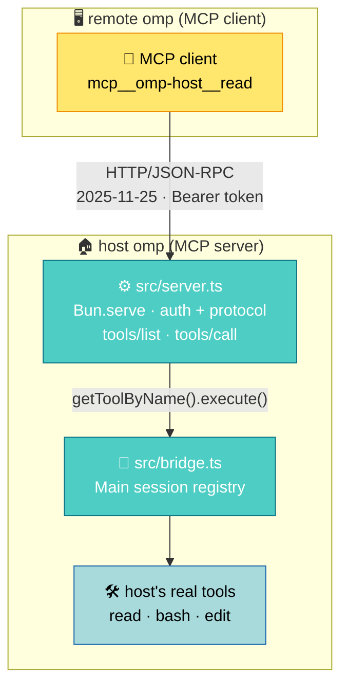

# a2mcp

[简体中文](README_ZN.md)

This is an omp extension. Once installed, the omp running on this machine also serves an MCP endpoint (MCP is the standard protocol for agents calling external tools): any program that speaks MCP — another omp, Claude Code, a curl script — can call this machine's tools (`read`, `bash`, `edit`…), and the commands run for real in this machine's shell, on this machine's files. The bridge itself never issues a model request: request in, tool run, result back — the reasoning is on the caller's side. It listens on `127.0.0.1` by default; reaching it from another machine means SSH port forwarding.

The name states the mechanism: **a2mcp** — Agent2MCP, one agent's tool surface handed to another agent over HTTP. The A2A in the old name is a different protocol, and this code implements none of it: no agent card, no task state machine, no `contextId` or `taskId`. What is on the wire is MCP `2025-11-25`, and the semantics are "the caller names a tool, the host runs it".

## Which one to use

The host ships `omp acp`: an editor starts it, hands it a prompt, and it calls a
model and does the work itself. **If you want a local agent that works for you,
use that.**

This bridge does no work. What arrives is a tool name and arguments; the bridge
hands them to the host to run and sends the result back unchanged — **the
thinking happens on the caller's side.** If what you want is "I reason, and I
borrow this machine's hands", use this bridge.

`ssh host 'omp acp'` is no substitute: what starts there is a different agent
doing its own reasoning, not your model.

| | `omp acp` | this bridge |
| --- | --- | --- |
| who reasons | omp | the caller |
| transport | stdio | Streamable HTTP + Bearer |
| who connects | a code editor | any MCP client |

## How it works



- The extension starts `Bun.serve` on `session_start` and implements MCP `2025-11-25`'s `initialize` / `tools/list` / `tools/call`, answering with plain JSON (no SSE).
- The endpoint is one per **process**; `session_start` / `session_shutdown` are one per **session**. A later `session_start` reuses the running server; a `session_shutdown` only releases the port once the registry holds no live `Main` session — otherwise any subagent finishing would take the port down with it. Release uses a non-forced `stop()`: new connections are refused, while a request already in flight finishes and gets its audit pair. The whole lifecycle is held by the entrypoint lifecycle unit tests (`docs/testing.md`).
- The catalog, the exposure gate and execution read one registry: the host's `Main` session. The catalog is that registry as-is, plus the bridge's own three `xfer_*` tools; nothing else is filtered or added (see [Security and boundaries](#security-and-boundaries)).
- The bridge itself issues no model requests: one remote call is "receive request, run tool, answer". But execution lands in the host's real session, and the side effects a tool leaves behind can wake the host's own agent — and that inference spends the host's tokens (see [Security and boundaries](#security-and-boundaries)). Whether the host may reason at all is the takeover switch's call: [Host inference takeover](#host-inference-takeover).

## Install

Two paths, and what separates them is whether the machine has `omp` yet: with a
host already installed, the single `omp install` command is the whole thing; on a
fresh machine, the one-shot script installs the host first and then runs that
same command.

### With omp (the machine already has omp)

```sh
omp install https://github.com/adam-ikari/a2mcp.git
```

This lands a checkout of the whole repository (measured 2.3 MB on disk, `docs/`
and `test/` included); the bridge itself only ever reads `extensions/` and
`src/`.

To remove it:

```sh
omp plugin uninstall a2mcp
```

Upgrading from v0.3.0 or earlier, retire the old name first — the plugin lock
records by package name, and with both entries registered the host loads both:

```sh
omp plugin uninstall pi-a2a-ext
```

After retiring the old name the config file and token are generated fresh, so
every remote `mcp.json` has to be re-copied.

The URL has to be the full `https://….git`: a GitHub `owner/repo` shorthand is
rejected as an invalid package name, and a `.tgz` path or URL is not accepted
either (the host tries to link it and fails with `ENOTDIR`). The package-name
spec — `omp install a2mcp` — is a reserved shape, not an available one: the
name is not on the registry, so that command fails in dependency resolution.
The bootstrap scripts already accept both shapes and derive version pins
accordingly; the name works the day the package is published, and not before.

### One-shot install (fresh machine)

**Linux**

```sh
curl -fsSL https://raw.githubusercontent.com/adam-ikari/a2mcp/HEAD/scripts/bootstrap.sh | sh -s -- --dry-run   # plan only
curl -fsSL https://raw.githubusercontent.com/adam-ikari/a2mcp/HEAD/scripts/bootstrap.sh | sh
```

**macOS** (identical to Linux)

```sh
curl -fsSL https://raw.githubusercontent.com/adam-ikari/a2mcp/HEAD/scripts/bootstrap.sh | sh -s -- --dry-run   # plan only
curl -fsSL https://raw.githubusercontent.com/adam-ikari/a2mcp/HEAD/scripts/bootstrap.sh | sh
```

**Windows** (PowerShell, runs in memory; nothing is saved to disk)

```powershell
powershell -NoProfile -ExecutionPolicy Bypass -Command "irm https://raw.githubusercontent.com/adam-ikari/a2mcp/HEAD/scripts/bootstrap.ps1 | iex"
```

To pass a switch (`-DryRun` and friends) use the scriptblock form, which keeps
the arguments out of the string that gets executed:

```powershell
& ([scriptblock]::Create((iwr -UseBasicParsing https://raw.githubusercontent.com/adam-ikari/a2mcp/HEAD/scripts/bootstrap.ps1).Content)) -DryRun
```

The script runs three steps: with no `omp` on PATH it calls the official
installer at the pinned version; then the one `omp install` above — the
extension has always had that single install command; then the host's own
`omp plugin doctor` closes it out. Remaining flags: `--upgrade` re-runs the
installer, `--reinstall` forces re-registration, `--uninstall` takes the
registration back (token and audit stay), `--host-version <version>` picks the
version and sends no request. The host self-updates at startup by default —
"installed at the pin" is not "stays at the pin". The script writes one file
outside the installer: a placeholder model config when it installed the host
itself and `~/.omp/agent/models.yml` did not exist (create-only; a machine with
`omp` already on PATH gets nothing — Troubleshooting says why it exists).

Either path ends the same way. Start the host and the notification bar shows:

```
a2mcp listening on http://127.0.0.1:<port> (token <first 6 chars>…)
```

`<port>` is the actual listening port (random by default). The bridge generates
its own config and token, so nothing is set up per machine; a machine with no
model configured opens a session anyway — the bridge fills the empty slot with
the placeholder model (Troubleshooting).

## Configuration

The config file is `~/.omp/agent/a2mcp.json`, generated on first start with mode `0600` (created at that mode, so there is no permission window):

```json
{ "port": 0, "token": "<base64url 32B>", "host": "127.0.0.1", "host_llm": "allow", "xfer": { "dufs": "dufs", "cloudflared": "cloudflared" } }
```

| Field | Meaning |
| --- | --- |
| `port` | `0` = random port; set a number to pin it |
| `token` | Bearer token, generated on first start (43 characters); a hand-written one under 32 characters is refused |
| `host` | Listen address, default `127.0.0.1` (a warning is added if you change it to `0.0.0.0`) |
| `host_llm` | `"deny"` \| `"allow"` (default): whether the host's own session may make model requests when it boots — see [Host inference takeover](#host-inference-takeover). It decides the **startup state only**; a running bridge can be toggled over HTTP regardless of what is written here |
| `xfer.dufs` | the HTTP file server that serves the shared path, default `dufs`: `PATH` first, else a pinned build is fetched into the bridge's own install directory (`~/.local/bin` on POSIX, `%LOCALAPPDATA%\a2mcp\bin` on Windows). A value containing `/` or `\` is used as given and never downloaded — see [Moving files](#moving-files) |
| `xfer.cloudflared` | the tunnel binary that publishes the share, default `cloudflared`: the same search, the same kind of pin (`2026.10.1` as of this writing) |

Only those fields: the four top-level ones plus an optional `xfer` block. **There is no tool allow/deny list and no file sandbox** — unknown fields are ignored, the bridge makes no permission decision for the host. `host_llm` is the exception: it gates the host's own inference, not what the caller may execute — that is decided by the token and the host's own tool permissions.

`A2MCP_CONFIG` overrides the config path; `A2MCP_AUDIT` overrides the audit log path; `A2MCP_INSTALLS` overrides where the bridge keeps its record of binaries it fetched.

Validation is **fail-closed**: a malformed field (`port` not an integer or out of range, `host` empty, `token` shorter than 32 characters or containing whitespace, `host_llm` neither `deny` nor `allow`) makes the extension refuse to start and names the field. The one exception is an **absent** `token`: it is generated and written back to the config. A token somebody typed is never replaced by one the bridge chose — that would break the remote `mcp.json` with no explanation anywhere. The floor sits below what `generateToken` emits (43 characters): it catches a placeholder, not a secret copied from elsewhere.

Config edits take effect on the **next host restart**; to change only the token at runtime, use `/a2mcp rotate` (immediate, and the old token stops working at once).

### Commands

Inside a host session:

- `/a2mcp` — show the current listen address, port and token prefix (the line carries the tunnel URL while one is open)
- `/a2mcp rotate` — rotate the token (update the remote `mcp.json` afterwards)
- `/a2mcp token` — print the full token (the status line only shows a prefix)
- `/a2mcp tunnel` — open a cloudflared quick tunnel in front of the MCP endpoint and print its public URL (`https://<random>.trycloudflare.com`). Runtime state, never in the config; see [Cross-machine forwarding](#cross-machine-forwarding)
- `/a2mcp tunnel stop` — close the tunnel

## Remote connection example

The remote omp's `mcp.json`:

```json
{
  "mcpServers": {
    "omp-host": {
      "type": "http",
      "url": "http://127.0.0.1:<port>/",
      "headers": { "Authorization": "Bearer <token>" }
    }
  }
}
```

Once connected, the remote side sees tools like `mcp__omp-host__read` and `mcp__omp-host__bash` and can call them directly.

## Two ways in

What separates them is whether your client already speaks MCP.

**Your client speaks MCP.** Point it at the bridge with the `mcp.json` above and stop there; do not write a client. The host's tools land in your tool list natively, and the handshake, the session header, and the reconnect are the MCP library's job, not yours.

**Your client can run code but is not an MCP client.** A coding agent handed the endpoint as text, a CI job, a script that has to drive `tools/call` itself: take `scripts/mcp-call.py`, a zero-dependency Python 3 reference client, and call the bridge through it instead of re-deriving the handshake each time.

```sh
curl -fsSL https://raw.githubusercontent.com/adam-ikari/a2mcp/HEAD/scripts/mcp-call.py -o mcp-call.py
python3 mcp-call.py --url http://127.0.0.1:<port>/ --token <token> list
python3 mcp-call.py --url http://127.0.0.1:<port>/ --token <token> call bash '{"command":"adb devices"}'
```

`list` prints each tool with the first line of its description; `call <name> <json>` runs one tool and prints its text output. The exit code is the signal — non-zero on a bad token, a transport error, or a result flagged `isError`. Every call carries a timeout (default 30s, `--timeout` to change), because a tool awaiting approval on a host with no UI hangs instead of erroring. `--url`/`--token` also read `A2MCP_URL`/`A2MCP_TOKEN`. The script is not in the install tarball, only at that raw URL, and it is a reference implementation — adapt it freely rather than treating it as a supported surface.

## Prompt for the remote agent

A remote agent will call the host's tools as if they were the same-named tools it already knows, and `tools/list` returns the host's registry verbatim — on this machine `edit` is a patch syntax (`[PATH#TAG]` plus `PUT N.=M:`), not `oldString`/`newString`, and a guess gets back `File not found`. Put the block below in its session or system prompt, replacing `<port>`, `<token>` and the tool prefix with the names from your `mcp.json`. If that agent is not registered as an MCP client and so has to run the calls itself, have it use `scripts/mcp-call.py` from [Two ways in](#two-ways-in) rather than write the handshake from scratch.

```text
You have been given the tools of another machine (the host) through the MCP server omp-host.

- These tools really execute on the host: bash runs in the host's shell, read/write/edit read and write files on the host's disk. Paths are host paths, not paths in your own environment — when unsure, run bash first and look at $HOME and pwd.
- The tool list and each tool's schema come from tools/list, and it holds exactly what the host currently has enabled. Read a tool's schema before calling it; it is not necessarily the same shape as the same-named tool you have used elsewhere.
- The host issues no model requests and has no agent working for you: bash/read return what they return, and the reasoning is yours.
- The host may require approval for some tools; with no interactive UI on the host, such a call hangs rather than erroring. Put a timeout on every call.
- If one command says it, do not split it across several round trips.
```

## Cross-machine forwarding

Loopback-only by default, never exposed to the network. Forward the port over SSH from the remote machine:

```sh
ssh -L <localport>:127.0.0.1:<port> user@host
```

Then set `mcp.json`'s `url` to `http://127.0.0.1:<localport>/`.

The second form is a tunnel, run from the host session: `/a2mcp tunnel` starts a cloudflared, points a random `https://<random>.trycloudflare.com` hostname at the bridge's port and prints the URL, which the remote side writes straight into `mcp.json`'s `url`. The shape to state plainly: with the tunnel open the endpoint is on the public internet and the Bearer token is the only gate. It is runtime state, the same class as the takeover switch: nothing is persisted, a restart clears it; `/a2mcp tunnel stop` closes it, and the bridge tears it down when the port goes away (no Main session left), so a public hostname never outlives the bridge that opened it. A `cloudflared` missing from PATH is fetched by the pinned version and sha256 in `xfer.cloudflared`, the exact same rules as [Moving files](#moving-files). Each open and close writes one audit record (`tool: "tunnel"`); the token never enters the record.

## Approval

Remote calls reuse the host's approval gate (`ExtensionToolWrapper`) entirely and open no additional permissions:

- The host's default `approvalMode` is `yolo` → straight through, no approval step.
- If the host configures a tool as `prompt` in `tools.approval` **and** the host has an interactive UI (TUI), the remote call raises an Approve/Deny prompt; once the user confirms, it continues and the result returns by the same path.
- With no interactive UI (measured in rpc mode; print takes the same no-UI path, untested), a `prompt` approval **neither executes the command nor returns**: the request hangs indefinitely (measured ≥90s) while the host waits for a UI answer that can never arrive. **Callers must impose their own timeout**; a hung call leaves a `start` record with no matching `done` in the audit log (see [Security and boundaries](#security-and-boundaries)).

## Host inference takeover

The measured wake-up chain (see [Security and boundaries](#security-and-boundaries)) showed the other half of the same fact: the host session can spend its own tokens without being asked. The takeover switch hands that decision to whoever holds the token.

**`deny` means the host's own session cannot make a model request.** Three layers, all runtime state, nothing persisted: the model row in the host's agent is swapped for a deny copy that only counts and only fails (a denied turn makes exactly one attempt, `retryable: false`, and does not even run the provider's key-retrieval program); `globalThis.fetch` is wrapped in a destination-keyed tripwire — any request whose URL host matches a `baseUrl` from the model configuration is refused, and this layer covers every fetch-based inference request (task subagents, web search, commit messages included); the only two non-fetch lanes (the cowork direct connection and the Codex websocket) have their provider names declared behind the deny — 2 of seventy-plus on a stock install. Why not shadow the whole registry: the registry's only undo primitive is "this extension unloaded", and shadowing everything would permanently delete what other extensions registered (measured against the real registry on 2026-10-13). A noise layer mutes the settings that would otherwise keep the host busy (auto-backgrounding, retries, advisor, auto-compaction, and so on), also runtime overrides; with the takeover armed, a remote 3-second `bash` runs to completion and ends there.

**Who controls it.** `host_llm` in the config decides the startup state (`allow` when unset). At runtime, `POST /host-llm` with `{"enabled": false}` arms the deny and `{"enabled": true}` restores from the snapshot; the reply is `{enabled, denied, degraded}`. Same Bearer token as everything else, and every toggle writes one audit record tagged `tool: "host_llm"` — a refused arming writes one too (`sid: null`). The endpoint is deliberately **not** a tool: `tools/list` stays the host registry verbatim. A toggle never persists — restart returns to the operator's config. Arming is redone on every `session_start`, because a rebuilt session comes with a registry nothing has shadowed. `/a2mcp` shows the current state (`host_llm=deny denied=2`).

**Degraded.** When the switch is on but the live session never got the deny row, the process-wide tripwire still stands and the two non-fetch lanes are bare: the reply carries `degraded: true` and `/a2mcp` prints `host_llm=deny (tripwire only)`. The refusal check runs before the old session is restored precisely so that a failed re-arm does not also tear the tripwire down on its way out.

**Residuals (each measured; the full list is in `docs/protocol.md` under 宿主推理切换):** a configuration that holds a `transport` on a provider the deny does not claim refuses arming — nothing is half-armed; a provider registered at runtime does not come back after restore, the host must restart; the host's non-inference catalog and metadata GETs leave the machine even when the hostname is a tripwire key; `deny` is not a network sandbox — `curl` from a `bash` tool runs in another process; a provider added while the bridge runs waits for the next arming to enter the snapshot; a denied turn still stays in the session history — the takeover limits what the host may do, not what it remembers.

## Moving files

Files move over plain HTTP: `xfer_share` hands a host path to [`dufs`](https://github.com/sigoden/dufs), which a cloudflared quick tunnel publishes under a public hostname; the reply is a URL with basic-auth credentials embedded (`https://omp:<secret>@<random>.trycloudflare.com/`), the local port and the expiry. Download with `curl -u omp:<secret> -O <host>/<name>`, upload with `-T`; Range requests resume, WebDAV clients work. The share closes at the TTL (default 3600s), on `xfer_stop`, or when the bridge stops; a second share replaces the first. `xfer_status` and `xfer_stop` take no arguments. The bytes never travel over JSON-RPC; the bridge ships no byte protocol of its own.

**The URL is a capability**: whoever holds it can read and write that path until the share closes.

The bridge finds both prerequisite binaries itself — `PATH` first, and when nothing answers there it fetches a build pinned by version and sha256 (`dufs` 0.46.0, `cloudflared` 2026.10.1, five platform rows each, in `src/obtain.ts`; every hash re-checked by `bun run test:obtain` against the bytes GitHub actually serves) into its own directory (`~/.local/bin` on POSIX, `%LOCALAPPDATA%\a2mcp\bin` on Windows). It never asks for `latest`, and never takes a checksum from the server that gave it the bytes. A configured value containing `/` or `\` is used as that path and nothing is downloaded. The bridge does not touch a file it did not install: it refuses to overwrite and prints that file's sha256. What was installed is accounted in `<agentDir>/a2mcp.installs.json`.

`win32-arm64` has no row, and the reason is upstream's: `cloudflared` ships no Windows ARM64 build, and one `xfer_share` needs both binaries — the bridge names the missing pair instead of installing half of one. The two win32 rows are verified to the byte, not to execution — the asset URLs answer, the zip hashes match, the entry reads out through the code path a Windows host will call, the `.exe` is a PE within the download cap, all inside `test:obtain`; the first `xfer_share` on Windows is also the first execution of those bytes.

A share that has to fetch waits for the fetch; the reply's `installed` names the version pulled (`null` when it was already on `PATH`). Every call writes one audit record (`tool: "xfer"`), and each fetch pairs with an `install` record.

## Devices

The host exposes devices in two shapes, and the bridge passes both through unchanged.

**Toolchains (`bash`).** `adb`, `idf.py`, serial tools and flashers are not omp tools — they are commands on this machine. `bash` is in `tools/list`, so a remote client runs them directly; whatever is on `PATH` is reachable:

```json
{ "jsonrpc": "2.0", "id": 1, "method": "tools/call",
  "params": { "name": "bash", "arguments": { "command": "adb devices -l" } } }
```

**Mounted devices (`xd://`).** The host mounts some tools as virtual devices — **they are not in `tools/list`** — driven through the `path` of `read` / `write`:

```json
{ "name": "read",  "arguments": { "path": "xd://" } }                    // list mounted devices
{ "name": "read",  "arguments": { "path": "xd://debug" } }               // docs + JSON schema
{ "name": "write", "arguments": { "path": "xd://debug", "content": { … } } }  // execute
```

The listing is decided by the host at runtime. Calling `xd://` directly through `tools/call` is refused (`not exposed`): a device is not a tool name, and only `read` / `write` reach it — that is the host's shape, the bridge does not rewrite it.

## Security and boundaries

- **The token is full tool-execution authority (under the default config)**: the host's default `approvalMode: yolo` means anyone holding the token can execute any exposed tool (including `bash`) directly in the host session with no approval step. Keep the config file at `0600` and out of version control.
- **The bridge makes no permission decision**: `tools/list` is the host's `Main` session registry passed through verbatim, plus the three `xfer_*` tools the bridge serves itself; it includes `hidden` tools and tools the host currently has disabled for its own model — **whatever permissions omp has are the permissions the bridge has**. To tighten anything, configure the host; the bridge has no second list.
- **Execution goes through the host's native tools**: the bridge injects the real settings and UI, so the host's approval gate applies as usual. The exception is the three `xfer_*` tools: the bridge dispatches them itself and they never pass that gate — a token holder can publish any path the bridge can read to a public URL.
- **A remote call can wake the host's own agent**: a long command past the host's command timeout (measured default: 300 seconds) is turned into a background job, and the completion notice wakes the host session to reason, spending the host's tokens. The countermeasure is the takeover switch — see [Host inference takeover](#host-inference-takeover).
- **Calls and the list share one source**: `tools/call` only accepts names that appear in `tools/list`; aliases and unregistered names are refused, and a refusal does not distinguish "filtered" from "nonexistent".
- **`POST /host-llm` is the path where the bridge has an opinion of its own**: it reaches into the host session directly (swapping registry rows, overriding settings, replacing the process `fetch`), and it pays for that with auditing (`tool: "host_llm"`) and documentation; what it limits is the host's own inference, and it acts only on the word of whoever holds the token.
- Loopback-only by default; if you really expose it, the firewall is your responsibility.
- **Sessions are mandatory**: every message except `initialize` must carry `Mcp-Session-Id` (missing → 400, unknown or idle past 24h → 404). At most 64 sessions, with the least-recently-seen evicted; every hit refreshes the timer.
- **Audit log**: every remote `tools/call` writes a start and a done JSONL record, paired by a UUID `id` generated inside the bridge, with `sid` attributing the call to a client session; the log sits at `~/.omp/agent/a2mcp.log`, mode `0600`, rotating past 512KB and keeping one generation. Long strings in the args are recorded as `<len, first 8 of sha256>` at any nesting depth — the host's `edit` puts the file body at the third level, and a redactor that stops two levels deep misses it. Writes are serialized inside the process: concurrent rotations overwrite each other's `.1`, a cost measured over six reruns. `start` reaches the disk before the tool runs and `done` before the response goes out: a 200 means the line is already there. Unauthorized attempts write nothing here at all — writing the audit is what drives rotation, and that lever should not be handed to somebody still guessing the token; those attempts go to the host's stderr. A `start` with no `done` means the call hung (typically an approval waiting for a UI that never comes); two catches when reading it — rotation can split one pair across two files, and only one generation is kept, so read it while it is still there. The full shape and numbers are in `docs/protocol.md` and `docs/testing.md`.
- If the configured port is busy, the bridge falls back to an ephemeral port and warns — update the remote `mcp.json`.

How this differs from computer use (guessing pixel coordinates on a screenshot) is in [docs/computer-use.md](docs/computer-use.md).

The full wire contract — request/response shapes, processing order, session lifecycle and the error-code table — is in [docs/protocol.md](docs/protocol.md).

Online docs (GitHub Pages, published on push): <https://adam-ikari.github.io/a2mcp/>

v1 boundaries: tools only (`tools/list` + `tools/call`), no resources, no prompts, no SSE, no call cancellation; always routed to the host's `Main` session; static Bearer token, no OAuth; no concurrency or rate limiting.

Design trade-off (read this before adding a feature):

- The bridge sends the call and adds no meaning on the way. A capability the host's own `read`/`bash`/`edit` can express gets no new tool; paths are not judged for the host; the catalog is not filtered on permission grounds. Give the bridge one opinion of its own and it becomes a second omp.
- A bridge-owned tool bypasses the host's approval gate, so it would need its own sandbox. **That is one decision with two halves, and they have to go together**: dropping only the sandbox leaves a hole nobody guards.


## Troubleshooting

- **First start on a machine with no model configuration**: the host still opens a session, and the bridge registers a placeholder provider `a2mcp/offline` at `session_start` and selects it. Its baseUrl points at `a2mcp.invalid`, an RFC 6761 reserved domain that can never resolve; the whole thing is runtime state — no file is written, and an operator's already-selected model is never overwritten, because the bridge only fills an empty slot. The MCP surface is therefore ready out of the box: the notification bar broadcasts and remote `initialize`/`tools/list` answer 200. The placeholder does not infer. A prompt on the host comes back as a connection-refused soft failure — measured on 18.12.1: `Couldn't connect to a2mcp.invalid (connection refused)` — and real inference always means `/login` and `/model`. Older hosts stop at `No model selected` (older still: `No models available`) on such a machine; that is the prompt-time gate, and upgrading the host is the fix. What the placeholder cannot reach is the headless start (`omp --mode rpc`): it dies inside `createAgentSession`, before any extension code runs, so only a `~/.omp/agent/models.yml` that exists before boot saves it. The one-shot scripts write exactly that file on exactly one branch: the script installed the host itself and the file was absent (create-only — an existing file is not read or touched, and a machine that already had `omp` on PATH gets nothing). A manually installed host that wants headless can write the same shape, documented under 占位模型 in `docs/protocol.md`. Probes run this unreachable shape daily on Linux and macOS; on Windows the script itself ran for the first time on 2026-10-19 (already-installed-host branch), and the `C:\Users\<user>\.omp\agent\models.yml` seeding path has never been executed there.
- **401 `unauthorized`**: the token does not match. The remote `mcp.json`'s `Authorization` header must equal the config's `token`; update the remote side after `/a2mcp rotate`. The host's stderr says `[a2mcp] N unauthorized attempt(s)` for the first failure and every 50th after it; those attempts stay out of the audit log on purpose (see the audit bullet under [Security and boundaries](#security-and-boundaries)).
- **The bridge refuses to start with `field 'token' must be at least 32 characters`**: somebody wrote a short token into `a2mcp.json`. Put a real secret there (or delete the field and let the bridge generate and persist one); the bridge will not swap out a token it was handed.
- **The bridge refuses to start with `field 'host_llm' must be 'deny' or 'allow'`**: the field was written with anything else (`"false"`, `"ALLOW"`, a boolean). The value decides the takeover's startup state; a fuzzy one is refused, not guessed (see [Host inference takeover](#host-inference-takeover)).
- **Takeover fails to arm** (a notice on `/a2mcp`, `[a2mcp] takeover failed to arm: …` on the host's stderr, and one `host_llm` audit record carrying an `error`): the model configuration contains a `transport` on a provider outside the claimed names (`pi-native`, or any transport that short-circuits before the API dispatch) — the bridge cannot get in front of it, so arming is refused and inference continues under the host's own rules. Remove or reconfigure that provider if deny is required.
- **`takeover restore left N provider(s) unregistered … restart the host to recover`** on the host's stderr: one of the two claimed providers had been registered at runtime by another extension rather than configured in `models.yml`, and the registry's undo cannot replay somebody else's registration. The deny itself is back in place; only that provider is missing until the host restarts.
- **No audit records, and no call failed**: the log path is unwritable — `$A2MCP_AUDIT` pointing into a directory that does not exist, a permission error, or a full disk. Host stderr carries `[a2mcp] audit record not written to <path> (<cause>)`. Fixing the path does not recover what was already lost.
- **400 `missing mcp-session-id` / 404 `unknown session`**: every message except `initialize` needs the session header. Sessions are in-memory in the host process — they all die when the host restarts and are reclaimed after 24h idle; run `initialize` again for a new session (a well-behaved MCP client library does this automatically).
- **Cannot connect / wrong port**: if the configured port is busy at host startup, the bridge falls back to a random port and warns in the notification bar — use the actual port shown there or in `/a2mcp` to update `mcp.json`.
- **A call never returns**: the host has no interactive UI and the tool's approval is `prompt` (see [Approval](#approval)) — the command does not execute, but neither does the call return; the caller must impose its own timeout, and the audit log shows a `start` with no `done` for that call (see the audit-log bullet under [Security and boundaries](#security-and-boundaries)).
- **500 `internal error`**: an internal server fault; the response body is deliberately detail-free (to avoid leaking), and the real cause is in the host's stderr as `[a2mcp] internal error: …`.
- **Config edits do not take effect**: external edits to `a2mcp.json` (such as `port`) need a host restart; only `/a2mcp rotate` applies live at runtime.
- **`bun test` version guard fails** (development): an installed `@oh-my-pi/pi-*` out of sync with the pin is restored by `bun install`; a local `omp --version` disagreeing with the pin means syncing the two exact versions in `package.json`. To deliberately run against a different host, set `A2MCP_SKIP_HOST_VERSION_CHECK=1` — it prints a loud SKIPPED rather than passing silently.

## Development

```sh
bun install

bun run typecheck     # type check
bun run lint          # lint + format check (Biome; fix with bunx biome check --write .)
bun run test:tree     # repo shape: no symlink points off this machine, 3 checks, no deps, no local omp (runs before bun test on purpose)
bun test              # unit tests: test/*.test.ts (233: protocol/auth/config/exposure gate/host hand-off/entrypoint lifecycle/audit/version guard/takeover shapes/arming transaction/host-llm route/xfer/obtain shapes incl. the win32 ones/placeholder model/the two bootstrap scripts)
bun run test:obtain   # the pinned binaries: fetches both for this platform, HEADs all ten asset URLs, reads the two Windows rows as bytes, 37 checks (needs no local omp; writes only inside its own /tmp directory)
bun run test:registry # drive the takeover against the host's real model registry, 28 checks, seconds (needs no local omp, no credentials)
bun run test:smoke    # real E2E (needs a local omp; no model credentials)
bun run test:hardening # real-host hardening checks, 34 items (needs a local omp)
bun run test:approval  # approval-boundary discriminating check, ~95s (needs a local omp)
bun run test:takeover  # host inference deny/restore against a counting sink, ~60s (needs a local omp)
bun run test:scenario  # end-to-end scenarios, 8 narratives / 41 steps, ~45s (needs a local omp)
bun run test:install   # published-package self-containment + a real host over MCP, 52 items (needs a local omp; fetches ~46 MB from GitHub and once installs the package from the registry — that group info-skips while the package is unpublished)
bun run test:mcp-call  # the reference client scripts/mcp-call.py against a real host + a fake 404 server, 6 checks (needs a local omp and python3; no python3 → the whole probe info-skips, exit 0)
bun run test:bootstrap # the one-shot installer's decisions, 47 items, ~9s (everything but the last group runs against a recording stub omp and a fake curl; the last group needs a local omp)
bun run website        # local docs site preview (VitePress); port is printed (5173 upward, next free if taken); first run `cd website && bun install`
```

What each test covers, the preconditions for the real-host checks, and how to read their verdicts (including the approval check's VERDICT A/B/C semantics) are in [docs/testing.md](docs/testing.md).

Dependency note: `@oh-my-pi/*` packages are pinned to **exact versions** in devDependencies, kept in step with the host omp, and used only for type checking and unit tests. At runtime the host's `omp:legacy-pi-shim` redirects those imports to its bundled copies — module-level singletons like `AgentRegistry.global()` only work when shared from that one copy. Update the version numbers when upgrading omp; the guard runs in `bun test`.

File layout:

| Path | Responsibility |
| --- | --- |
| `extensions/a2mcp.ts` | Extension entry point: starts the server on `session_start`, registers `/a2mcp` |
| `src/server.ts` | `Bun.serve` + JSON-RPC (MCP 2025-11-25, plain JSON responses), sessions and version negotiation |
| `src/bridge.ts` | Tool catalog and execution (both through the AgentRegistry `Main` session, with the pinned `pi.getAllTools` only as the no-live-Main fallback), exposure-intersection decision |
| `src/config.ts` | Config load/save, field validation, token generation |
| `src/auth.ts` | Bearer token verification (timing-safe comparison) |
| `src/audit.ts` | Audit log for remote calls (two-phase JSONL `start`/`done`, rotation) |
| `src/takeover.ts` | Host inference takeover: deny api plus the host's current model row, destination fetch tripwire, provider shadowing limited to the non-fetch lanes, noise overrides, snapshot and restore |

Change history: [CHANGELOG.md](CHANGELOG.md).

## License

MIT, see [LICENSE](LICENSE).
