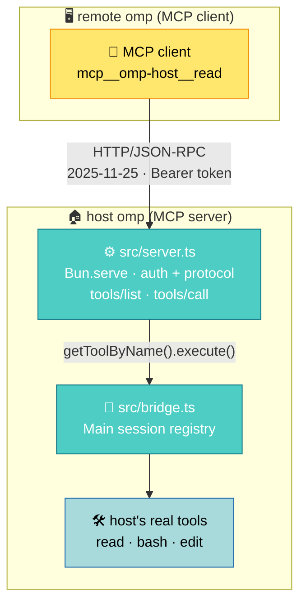

# omp A2A Bridge

[简体中文](README_ZN.md)

This is an omp extension. Once installed, the omp running on this machine also serves an MCP endpoint (MCP is the standard protocol for agents calling external tools): any program that speaks MCP — another omp, Claude Code, a curl script — can call this machine's tools (`read`, `bash`, `edit`…), and the commands run for real in this machine's shell, on this machine's files. The bridge itself never issues a model request: request in, tool run, result back — the reasoning is on the caller's side. It listens on `127.0.0.1` by default; reaching it from another machine means SSH port forwarding.

## Which one to use

The host ships `omp acp`: an editor (Zed, say) starts it, hands it a prompt, and it
calls a model and does the work itself, streaming the result back to the editor.
**If you want a local agent that works for you, use that.**

This bridge does no work. What arrives is a tool name and arguments; the bridge
hands them to the host and sends the result back unchanged — **the thinking happens
on the caller's side.** So if what you want is "I reason, and I borrow this
machine's hands", use this bridge.

Neither substitutes for the other. `ssh host 'omp acp'` is no help either: what
starts there is a different agent doing its own reasoning, not your model.

| | `omp acp` | this bridge |
| --- | --- | --- |
| who reasons | omp | the caller |
| transport | stdio | Streamable HTTP + Bearer |
| who connects | a code editor | any MCP client |

## How it works



- The extension starts `Bun.serve` on `session_start` and implements MCP `2025-11-25`'s `initialize` / `tools/list` / `tools/call`, answering with plain JSON (no SSE).
- The endpoint is one per **process**; the host's `session_start` / `session_shutdown` are one per **session** (a task subagent's runner, an ACP session, a persisted revive each get their own). A later `session_start` reuses the running server (two in flight at once bind only one endpoint), and a `session_shutdown` only releases the port once the host registry holds no live `Main` session (`AgentRef.session` is null exactly when it is parked or aborted, and `tools/call` already refuses that state) — otherwise any subagent finishing would take the endpoint down with it. A shutdown that lands mid-bind has no port to stop yet, so the start re-reads the registry when the bind finishes and gives up what it just bound if `Main` is gone. Releasing uses a non-forced `stop()`: the listener closes at once and new connections are refused, while a request already in flight finishes and gets its audit pair — a forced close would leave a `tools/call` with half its record and a `POST /blob` with none.
- The catalog, the exposure gate and execution read one registry: the host's `Main` session (`getAllToolInfos()`, which is exactly what the host wires `pi.getAllTools()` to). Execution then resolves the name through that same session's `getToolByName`. With no live `Main` (parked or aborted, before the port is released) the catalog falls back to the runner the entry is pinned to instead of reporting an empty registry.
- The catalog is the host registry as-is; the bridge does not filter it (see [Security and boundaries](#security-and-boundaries)).
- The bridge itself issues no model requests: one remote call is "receive request, run tool, answer". But execution lands in the host's real session, and the session-level side effects a tool leaves behind can wake the host's own agent — and that inference spends the host's tokens (see [Security and boundaries](#security-and-boundaries)). Whether the host may reason at all is itself controllable from the remote side: [Host inference takeover](#host-inference-takeover).

## Install

On any machine, from the git URL:

```sh
omp install https://github.com/adam-ikari/pi-a2a-ext.git
```

That installs it into `~/.omp/plugins/node_modules/pi-a2a-ext`. To remove it:

```sh
omp plugin uninstall pi-a2a-ext
```

**That is the only install path.** `omp install` itself also takes a directory and
npm specs, but this extension does not offer a local install: what you install is
the repository behind the git URL above. The `pi.extensions` field in
`package.json` is what tells omp which entry file to load, so do not remove it.

The URL has to be the full `https://….git` — a GitHub `owner/repo` shorthand is
rejected as an invalid package name, and pointing it at a `.tgz` fails with
`ENOTDIR`.

All of the above was measured, and `bun run test:install` checks the package, then
starts a host and drives the bridge over MCP as a remote client. One thing it
cannot do is pretend the machine is clean: the host resolves `~/.omp/plugins`
independently of `HOME`, and no env var redirects it — so that half runs against
the real plugin directory an `omp install` writes to. See
[docs/testing.md](docs/testing.md).

Nor hand-symlink into `~/.omp/agent/extensions/`:
`ln -s "$PWD/extensions/a2a-bridge.ts" ...` only works when `$PWD` happens to be
the repo root. Run it from anywhere else and it links a path that does not exist,
the bridge never comes up, and the host says nothing about it.

On first start the bridge generates its own config and token under
`~/.omp/agent/`, so there is nothing else to set up per machine.

After starting the host omp, the notification bar shows:

```
A2A bridge listening on http://127.0.0.1:<port> (token <first 6 chars>…)
```

`<port>` is the actual listening port (random by default).

## Configuration

The config file is `~/.omp/agent/a2a-bridge.json`, generated on first start with mode `0600` (created at that mode, so there is no permission window):

```json
{ "port": 0, "token": "<base64url 32B>", "host": "127.0.0.1", "host_llm": "allow" }
```

| Field | Meaning |
| --- | --- |
| `port` | `0` = random port; set a number to pin it |
| `token` | Bearer token, generated on first start (43 characters); a hand-written one under 32 characters is refused |
| `host` | Listen address, default `127.0.0.1` (a warning is added if you change it to `0.0.0.0`) |
| `host_llm` | `"deny"` \| `"allow"` (default): whether the host's own session may make model requests when it boots — see [Host inference takeover](#host-inference-takeover). It decides the **startup state only**; a running bridge can be toggled over HTTP regardless of what is written here |

Only those four. **There is no tool allow/deny list and no file sandbox** — the bridge makes no permission decision of its own, so adding such fields to the config has no effect (unknown fields are ignored). `host_llm` is not a tool permission either: it gates the host's *own inference*, not what the caller may execute — the caller holds the token and runs whatever the host exposes.

`A2A_BRIDGE_CONFIG` overrides the config path; `A2A_BRIDGE_AUDIT` overrides the audit log path.

Validation is **fail-closed**: a present-but-malformed field (`port` not an integer or out of range, `host` not a non-empty string, `token` shorter than 32 characters or containing whitespace) makes the extension refuse to start and report an error. The one exception is a `token` that is **absent** (or not a string at all): it is regenerated and **written back to the config**, so it stays stable across restarts. A token somebody typed is never replaced by one the bridge chose — that would break the remote `mcp.json` with no explanation anywhere. The floor sits below what `generateToken` emits (43 characters), so it catches a placeholder, not a secret copied from elsewhere.

Config edits take effect on the **next host restart**; to change only the token at runtime, use `/a2a rotate` (immediate, and the old token stops working at once).

### Commands

Inside a host session:

- `/a2a` — show the current listen address, port and token prefix
- `/a2a rotate` — rotate the token (update the remote `mcp.json` afterwards)
- `/a2a token` — print the full token (the status line only shows a prefix)

## Remote connection example

The remote omp's `mcp.json`:

```json
{
  "mcpServers": {
    "omp-host": {
      "type": "http",
      "url": "http://127.0.0.1:<port>/",
      "headers": { "Authorization": "Bearer <token>" }
    }
  }
}
```

Once connected, the remote side sees tools like `mcp__omp-host__read` and `mcp__omp-host__bash` and can call them directly.

## Cross-machine forwarding

Loopback-only by default, never exposed to the network. Forward the port over SSH from the remote machine:

```sh
ssh -L <localport>:127.0.0.1:<port> user@host
```

Then set `mcp.json`'s `url` to `http://127.0.0.1:<localport>/`.

## Approval

Remote calls reuse the host's approval gate (`ExtensionToolWrapper`) entirely and open no additional permissions:

- The host's default `approvalMode` is `yolo` → straight through, no approval step.
- If the host configures a tool as `prompt` in `tools.approval` **and** the host has an interactive UI (TUI), the remote call raises an Approve/Deny prompt; once the user confirms, it continues and the result returns by the same path.
- With no interactive UI (measured in rpc mode; print takes the same no-UI path but is untested), a `prompt` approval **neither executes the command nor returns**: the request hangs indefinitely (measured ≥90s) while the host waits for a UI answer that can never arrive. **Callers must impose their own timeout**; a hung call leaves a `start` record with no matching `done` in the audit log (see below), so it is detectable.

## Host inference takeover

The measured wake-up chain (see [Security and boundaries](#security-and-boundaries)) showed the other half of the same fact: the host session can spend its own tokens without being asked. The takeover switch hands that decision to whoever holds the token.

**`deny` means the host's own session cannot make a model request.** Three layers, divided by which door a given inference request finally leaves through — a division read off the host's own source, not assumed:

- **A deny API plus the model row the host is holding.** `a2a-deny` is registered as a custom API whose `streamSimple` only counts and fails, and the row the host's agent holds is swapped for a deny copy of itself. The host's own turn is therefore refused before a request is built: one attempt, one stderr line, and the error `a2a-bridge takeover: host inference is disabled in this mode`. The text matches none of the host's retry triggers — measured on a live host, a denied turn makes exactly one attempt and ends with `retryable: false`. The deny copy carries no credential resolver, so a refused turn does not even run the provider's `!command` key program.
- **A destination-keyed tripwire** on the host process's `globalThis.fetch`: any request whose URL host matches a `baseUrl` from the model configuration is refused. pi-ai resolves its fetch as `options.fetch ?? globalThis.fetch`, reading the global binding per call, so this covers every fetch-based inference request — including callers that build their own registry (task runners, web search, commit messages) instead of asking the session's.
- **Registry shadowing, for the two providers whose requests skip fetch.** Two lanes are not fetches: the cowork lane (`provider: anthropic` with `api: anthropic-messages`, where the host swaps in a raw `node:https` client) and the Codex websocket lane (`api: openai-codex-responses`, where the host forwards the `providers.openaiWebsockets` setting on every provider call). Those provider names go behind the deny; on a stock install that is 2 of 73.

**Why not "shadow every provider".** The host's `registerProvider(name, …, sourceId)` records `sourceId` as that name's owner and, when someone else owned it, clears the incumbent's runtime state before taking over; the only undo the public API offers is "this extension unloaded", not "undo that one call". Shadowing everything therefore deletes every provider another extension registered — once per arming, never restored. Measured 2026-10-13 against the real registry: a two-row provider an extension had registered went to zero rows after one arm/restore cycle. So the table above claims a name only where a lane forces it, and restore checks the claimed providers against the pre-arm snapshot instead of assuming the undo was clean, naming any that did not come back.

A noise layer mutes the settings that would otherwise keep the host busy and chatty (auto-backgrounding of long commands, host-side retries, advisor, TTSR, prewalk, autolearn, cache warming, auto-compaction) — runtime overrides, nothing persisted. Measured: with the takeover armed, a remote 3-second `bash` runs to completion instead of becoming a background job.

**Who controls it.** `host_llm` in the config decides the startup state (`allow` when unset). At runtime, `POST /host-llm` with `{"enabled": false}` arms the deny and `{"enabled": true}` restores what the takeover snapshotted (the deny API is unregistered, claimed providers restored, the original model row put back, the fetch reference and settings overrides rolled back); the reply is `{enabled, denied, degraded}`. Same Bearer token as everything else, and every toggle writes one audit record tagged `tool: "host_llm"` — a refused arming writes one too (`sid: null`, since no caller asked) plus a stderr line, because a toast scrolls away and an audit record does not. The endpoint is deliberately **not** a tool: `tools/list` stays the host registry verbatim. `/a2a` shows the live state (`host_llm=deny denied=2`). A toggle never persists — restart returns to the operator's config. Arming is redone on every `session_start`, whether the config or a remote caller turned it on: a rebuilt session comes with a registry nothing has shadowed, and a listening port says nothing about the registry's state. The arm line names the claimed providers (`takeover armed: 2 provider(s) shadowed (anthropic, openai-codex), …`) — a claim takes a name away from whoever held it and the registry cannot give it back, so that line is the only place the operator can see which names the bridge holds.

**Degraded.** A refusal while the switch is on is not the same as a refusal at startup. The switch stays on and the process-global tripwire stays installed, but the session that is live now never got the deny row or the claims — so its two non-fetch lanes are unguarded. The reply carries `degraded: true`, `/a2a` prints `host_llm=deny (tripwire only)`, and stderr plus the audit say so. The refusal check runs before the old session is restored precisely so that a failed re-arm does not also tear down the tripwire on its way out.

**What it gives up, and what stays outside the promise.**

- A `transport` (`pi-native` and anything else that dispatches before the api check) runs inside the host ahead of any extension-registered implementation, so the bridge cannot get in front of it. The takeover **refuses to arm** when the configuration contains one on a provider it does not claim — visible error, nothing half-armed. Where deny is truly required, the config gets fixed, not the bridge.
- Provider ownership cannot be handed back. If one of the two claimed providers was registered at runtime by another extension (rather than configured in `models.yml`), that registration does not survive the restore: the undo primitive has no way to replay it. Restore names it, and recovering it means restarting the host.
- A request that does not go through `globalThis.fetch` is not this bridge's to refuse. The registry captures its own fetch at construction, so the host's catalog and metadata GETs to a provider's own baseUrl leave the machine even while that host is a tripwire key — measured, one non-POST per takeover-probe run, printed separately from the inference count. Non-inference egress is deliberately not blocked; what is deliberately *not* true is "a keyed host is always refused".
- The tripwire watches the host process. `curl` from a `bash` tool runs in another process — `deny` is not a network sandbox and does not claim to be. (Measured: a denied-state task sub-agent resolves its own model through its own freshly built registry, so its request is refused at the fetch boundary — one local refusal, nothing leaves the machine.)
- A provider added to `models.yml` while the bridge runs is not in the snapshot until the next arming, and `/login` hands model ownership back to the host, lifting the shadow on a claimed provider.
- A host that swaps its model row back to a real row while armed loses nothing — it lands on the tripwire — but restore will not swap it back to the deny copy: that was the operator's choice.
- `title.generator` has no off value in its enum (`fork | tiny`), so the host still attempts session titles; those attempts fail closed at the deny, and their error notices can appear in the session.
- Denied turns are turns: they leave an error message in the host's session history. The takeover limits what the host may do, not what it remembers.

## Moving files

To put a firmware image or another binary on the host, use `POST /blob`. **It takes
raw bytes, and what that buys is not the size — it is that it does not hang.**

The host's writing tools (`write`, `edit`) and its `bash` all pass the approval
gate. When the host has `prompt` configured for them and the caller has no
interactive UI, that gate **never gets an answer** — measured hanging ≥90s without
returning (see [Approval](#approval); the approval probe runs this every round and
expects `VERDICT: B`). For a headless remote caller in that configuration, `/blob`
is the only write path that does not hang. Bypassing the gate is therefore the
reason it exists there, not a side effect.

Saving the base64 step is the smaller part of it (`base64 -d >` inside `bash`
works too, at 33% more bytes and one encode). What only `/blob` does is a 100 MB
image in a single request:

```sh
curl -X POST --data-binary @firmware.bin \
  -H "Authorization: Bearer $TOKEN" \
  "http://127.0.0.1:<port>/blob?path=/tmp/firmware.bin"
```

One request carries up to 128 MB — measured every probe round: a 100 MB image goes
through in a single call, byte-identical. No `offset` means append; with `offset` it must equal
the file's current size, or 409. Larger files chunk, still as raw bytes. The full
contract is in [docs/protocol.md](docs/protocol.md).

Mind the memory: Bun buffers the body before the handler sees it, so the cost is
**per in-flight request** — ten concurrent 100 MB uploads are ten 100 MB buffers, and
that arithmetic needs no measurement. Host RSS around uploads is measured each probe
round and the current table lives in [docs/protocol.md](docs/protocol.md); the numbers
move with Bun's allocator, so treat them as scale, not as a budget. Keep concurrency
down.

**Download does not work.** Three host-side limits stack, and any one alone is enough:

- `read` refuses a single line over 150 KB (`exceeds 150.0KB limit`); a 1 MB
  multi-line file comes back as roughly 16 KB
- `bash` output past 768 bytes is truncated, with a pointer to `artifact://N`
- `read artifact://N` is itself truncated at about 150 KB

So a remote agent cannot pull a large file off the host, only read small slices
(measured: 20 `dd` slices recovered about 3.2 MB of a 4 MB file). `/blob` covers
upload only.

For plain text or small files the `write` tool is simpler — about 900 KB per call —
though it does not use `/blob`'s path.

## Devices

The host exposes devices in two shapes, and both pass through unchanged.

**Toolchains (`bash`).** `adb`, `idf.py`, serial tools and flashers are not omp tools — they are commands on this machine. `bash` is in `tools/list`, so a remote client runs them directly:

```json
{ "jsonrpc": "2.0", "id": 1, "method": "tools/call",
  "params": { "name": "bash", "arguments": { "command": "adb devices -l" } } }
```

Execution lands in the local shell, so whatever is on `PATH` is reachable: with the Android SDK installed, `adb` is callable; with ESP-IDF installed, `idf.py flash` is. Port monitors and register pokes work the same way.

**Mounted devices (`xd://`).** The host mounts tools as virtual devices. **They are not in `tools/list`** — they are driven through the `path` argument of `read` / `write`:

```json
{ "name": "read",  "arguments": { "path": "xd://" } }                    // list mounted devices
{ "name": "read",  "arguments": { "path": "xd://debug" } }               // docs + JSON schema
{ "name": "write", "arguments": { "path": "xd://debug", "content": { … } } }  // execute
```

The listing is decided by the host at runtime — it depends on which extensions are installed and which devices are attached. Measured on this machine: `xd://debug` (a DAP debugger), `xd://lsp`, `xd://ast_edit`.

**Calling `xd://` directly through `tools/call` is refused** (`not exposed`): a device is not a tool name, and only the `path` of `read` / `write` reaches it. That is the host's shape; the bridge does not rewrite it.

## Security and boundaries

- **The token is full tool-execution authority (under the default config)**: the host's default `approvalMode: yolo` means anyone holding the token can execute any exposed tool (including `bash`) directly in the host session with no approval step; only tools the host configures as `prompt` have a gate that can stop them (see [Approval](#approval) for the no-UI case). Keep the config file at `0600` and out of version control.
- **The bridge makes no permission decision**: `tools/list` is the host's `Main` session registry (`getAllToolInfos()`), passed through verbatim with no filtering. It therefore includes `hidden` tools and tools the host currently has disabled for its own model — **whatever permissions omp has are the permissions the bridge has**. There is no second list such as `deny`: two lists can disagree, and no code defines which wins. To tighten anything, configure the host's own tool permissions; the bridge stays out of it.
- **Execution goes through the host's native tools**: `tools/call` routes to `getToolByName().execute()` on the host's `Main` session with the real `session.settings` and `ExtensionContext ui` injected, so the host's approval gate (`ExtensionToolWrapper`) applies as usual. The bridge implements no approval logic of its own.
- **A remote call can wake the host's own agent.** The bridge never issues a model request, but the host owns execution: a remote `bash` that exceeds the host's command timeout (measured default: 300 seconds) is converted by the host into a background job, and when the job finishes the host injects a completion notice into the session ("Background job … has completed. Resume your work…"). The host session's own agent loop wakes on that notice, starts inferring and running its own local tools. Measured chain on a Windows host: call timed out and became a background job (04:35:23) → completion notice entered the session (04:36:27) → the host's first assistant messages with real usage (04:36:31, model stack/medium, first turn at 8,309 input tokens), dozens of turns after that. This is not the bridge reasoning — it is a consequence of the tool landing in the host session, and the tokens spent are the host's. The host's side of this is a switch, not a fate: with the takeover armed (`host_llm: "deny"` or `POST /host-llm`), the woken session makes zero model requests — see [Host inference takeover](#host-inference-takeover).
- **Calls and the list share one source**: `tools/call` only accepts names that appear in `tools/list`; aliases (such as `xd://bash`) and unregistered names are refused, and a refusal does not distinguish "filtered" from "nonexistent" (so it does not leak whether a name exists).
- **`POST /blob` is an exception, and it does not pass the host approval gate.** It takes raw bytes (skipping base64) and writes them directly, resolving the path itself — so it can write **anywhere the host process can write, with no root and no allowlist**. That is deliberate: an extension cannot raise an approval request of its own (`ExtensionAPI` only offers `on("tool_approval_requested", …)`, which is the host asking and the extension answering), and the one way to write through the gate is a `tools/call` — the very encoding `/blob` exists to avoid. Auditing still happens, tagged `tool: "blob:write"` with `path`/`offset`/`bytes` in args and never the file contents. One consequence of resolving paths here is that the bridge's own two files sit under the root it resolves against — `a2a-bridge.json` and `a2a-bridge.log` are both in the agent directory, and so is every relative `path`. Neither can be rewritten (writes append, and an explicit `offset` has to equal the current size), but appending junk to the config makes the next `loadConfig` throw and the bridge refuse to start, and pumping volume into the log drives the rotations that drop a retained generation. Startup and evidence, not new reach: whoever can do this already holds the token. See [docs/protocol.md](docs/protocol.md).
- **`POST /host-llm` is the bridge's second path that is not a tool.** It reaches into the host session directly — swapping registry rows, overriding settings, replacing the process `fetch` — the same category of exception as `/blob`: the bridge holds an opinion, bypasses the host's tool dispatch, and pays for it with auditing (`tool: "host_llm"`, one record per toggle) and documentation. What it limits is the host's own inference, and it acts only on the word of whoever holds the token. See [Host inference takeover](#host-inference-takeover).
- Loopback-only by default; if you really do expose it, the firewall is your responsibility.
- **Sessions are mandatory**: every message except `initialize` must carry `Mcp-Session-Id` (missing → 400, unknown or idle past 24h → 404). At most 64 sessions are tracked, with the least-recently-seen evicted beyond that; every hit refreshes the idle timer.
- **Audit log**: every remote `tools/call` writes two JSONL records — `{ts,id,sid,phase:"start",tool,args}` at dispatch and `{ts,id,sid,phase:"done",tool,isError,args}` on completion (paired by the same `id`; `sid` is that call's `Mcp-Session-Id`, so under a shared token each call is attributable to a client session; the args summary is truncated to 1KB) — to `~/.omp/agent/a2a-bridge.log`, mode 0600, rotating to `.1` past 512KB. The `id` is a UUID the bridge generates for pairing; the caller's JSON-RPC id is not written, so the log cannot be searched by it. Strings longer than 120 characters in the args are recorded as `<len:N,sha256:first 8>` so the log never holds payloads — at any nesting depth, not just the top levels: the host's `edit` args put the file body at `args.edits[0].oldText`, and a redactor that stops two levels deep writes it out. Nesting past 32 levels is replaced by `<max-depth>` rather than walked. This is the bridge's own log: the host session still sees the args it was handed, and its transcript is the host's to keep. Records reach the disk through one queue per process, because `stat`-then-rotate-then-append is three steps: two calls in flight together both read a size past the cap and both rotate, and the second `rename` overwrites the `.1` the first one just filled. Measured on the unqueued version over six runs: the worst left one record in each of the two files, 570 of the 572 records the test had put on disk being in neither. Audit write failures never affect the call, and they do not pass unnoticed either: the first failure for a log path prints `[a2a-bridge] audit record not written to <path> (<cause>)` to the host's stderr, then every hundredth failure, because a log that cannot be written looks exactly like a bridge that was never called. `start` reaches the disk before the tool runs and `done` before the response goes out, so a 200 means the line is already there and a caller can read the log without polling for it. That was the other way round before — records rode one process-wide queue the caller never waited on — and it showed up only when the disk was slow enough for the queue to matter; measured cost of waiting is ~99 µs per record (`stat` + `appendFile` + `chmod`, serialized), which is nothing against a call that runs a bash command. A `blob:write` record reaches the disk before the response reads the file's size back, so a failed read after a landed write costs a field in the response rather than the trace. `POST /blob` fills `sid` from sessions this bridge issued only; a header from outside is recorded as `null`, because a caller-chosen value lets any token holder file a write under somebody else's session. Unauthorized attempts write nothing here at all — they go to the host's stderr, first one and then every 50th — since handing pre-auth traffic the one lever that ages real records out of a rolling window costs more than the missing line is worth.
- **A `start` with no `done` means the call was dispatched but never completed** (typically: an approval hung for want of a UI). Two catches on reading that signal, both measured: rotation can split one call's pair across `.1` and the current file, so pair by `id` in both files; and only ONE generation is retained, because the next rotation overwrites `.1` — the evidence of a hung call ages out of the log after enough later traffic. Read it while it is still there.
- If the configured port is busy, the bridge falls back to an ephemeral port and warns (update the port in the remote `mcp.json`).

How this differs from computer use (guessing pixel coordinates on a screenshot) is in [docs/computer-use.md](docs/computer-use.md).

The full wire contract — request/response shapes, processing order, session lifecycle and the error-code table — is in [docs/protocol.md](docs/protocol.md).

Online docs (GitHub Pages, published on push): <https://adam-ikari.github.io/pi-a2a-ext/>

v1 boundaries:

- Tools only (`tools/list` + `tools/call`); no resources, no prompts.
- No SSE push, no call cancellation.
- Always routed to the host's `Main` session.
- Static Bearer token, no OAuth.
- No concurrency or rate limiting.

Design trade-off (read this before adding a feature):

- The bridge sends the call and adds no meaning on the way. A capability the host's own `read`/`bash`/`edit` can express gets no new tool; paths are not judged here; the catalog is not filtered on permission grounds — **whatever permissions omp has are the permissions the bridge has**. Give the bridge one opinion of its own and it becomes a second omp.
- A bridge-owned tool bypasses the host's approval gate, so it would need its own sandbox. **That is one decision with two halves, and they have to go together**: dropping only the sandbox leaves a hole nobody guards.


## Troubleshooting

- **401 `unauthorized`**: the token does not match. The remote `mcp.json`'s `Authorization` header must equal the config's `token`; update the remote side after `/a2a rotate`. The host's stderr says `[a2a-bridge] N unauthorized attempt(s)` for the first failure and every 50th after it; those attempts stay out of the audit log on purpose (see the audit bullet under [Security and boundaries](#security-and-boundaries)).
- **The bridge refuses to start with `field 'token' must be at least 32 characters`**: somebody wrote a short token into `a2a-bridge.json`. Put a real secret there (or delete the field and let the bridge generate and persist one); the bridge will not swap out a token it was handed.
- **The bridge refuses to start with `field 'host_llm' must be 'deny' or 'allow'`**: the field was written with anything else (`"false"`, `"ALLOW"`, a boolean). The value decides the takeover's startup state; a fuzzy one is refused, not guessed (see [Host inference takeover](#host-inference-takeover)).
- **Takeover fails to arm** (`A2A takeover failed to arm: … transport 'pi-native' …` on `/a2a`, on stderr as `[a2a-bridge] takeover failed to arm: …`, and as one `host_llm` audit record with an `error`): the model configuration contains a `transport` on a provider the deny does not claim, which the bridge cannot honestly intercept, so arming is refused and inference continues under the host's own rules. Remove or reconfigure that provider if deny is required.
- **`takeover restore left N provider(s) unregistered … restart the host to recover`** on the host's stderr: one of the two claimed providers had been registered at runtime by another extension rather than configured in `models.yml`, and the registry's undo cannot replay somebody else's registration. The deny itself is back in place; only that provider is missing until the host restarts.
- **No audit records, and no call failed**: the log path is unwritable — `$A2A_BRIDGE_AUDIT` pointing into a directory that does not exist, a permission error, or a full disk. Host stderr carries `[a2a-bridge] audit record not written to <path> (<cause>)`. Fixing the path does not recover what was already lost.
- **400 `missing mcp-session-id` / 404 `unknown session`**: every message except `initialize` needs the session header. Sessions are in-memory in the host process — they all die when the host restarts and are reclaimed after 24h idle; run `initialize` again for a new session (a well-behaved MCP client library does this automatically).
- **Cannot connect / wrong port**: if the configured port is busy at host startup, the bridge falls back to a random port and warns in the notification bar — use the actual port shown there or in `/a2a` to update `mcp.json`.
- **A call never returns**: the host has no interactive UI and the tool's approval is `prompt` (see [Approval](#approval)) — the command does not execute, but neither does the call return; the caller must impose its own timeout, and the audit log shows a `start` with no `done` for that call (see the audit-log bullet under [Security and boundaries](#security-and-boundaries)).
- **500 `internal error`**: an internal server fault; the response body is deliberately detail-free (to avoid leaking), and the real cause is in the host's stderr as `[a2a-bridge] internal error: …`.
- **Config edits do not take effect**: external edits to `a2a-bridge.json` (such as `port`) need a host restart; only `/a2a rotate` applies live at runtime.
- **`bun test` version guard fails** (development): either the installed `@oh-my-pi/pi-*` is out of sync with the pin/lock (`bun install` restores it), or the local `omp --version` disagrees with the pin (update the two exact versions in `package.json` when you upgrade the host). The host comparison used to warn only, which let the pin drift unnoticed; it fails now, and is skipped only when there is no host on `PATH`. To run against a deliberately different host, set `A2A_SKIP_HOST_VERSION_CHECK=1` — it prints a loud SKIPPED rather than passing silently.

## Development

```sh
bun install

bun run typecheck     # type check
bun run lint          # lint + format check (Biome; fix with bunx biome check --write .)
bun run test:tree     # repo shape: no symlink points off this machine, 3 checks, no deps, no local omp (runs before bun test on purpose)
bun test              # unit tests: test/*.test.ts (161: protocol/auth/config/exposure gate/host hand-off/entrypoint lifecycle/audit/version guard/blob dispatch/takeover shapes/arming transaction/host-llm route)
bun run test:registry # drive the takeover against the host's real model registry, 28 checks, seconds (needs no local omp, no credentials)
bun run test:smoke    # real E2E (needs a local omp; no model credentials)
bun run test:hardening # real-host hardening checks, 34 items (needs a local omp)
bun run test:blob      # POST /blob raw-byte upload, 35 items (needs a local omp)
bun run test:approval  # approval-boundary discriminating check, ~95s (needs a local omp)
bun run test:takeover  # host inference deny/restore against a counting sink, ~60s (needs a local omp)
bun run test:scenario  # end-to-end scenarios, 10 narratives / 54 steps, ~45s (needs a local omp)
bun run test:install   # published-package self-containment + a real host over MCP, 33 items (needs a local omp)
bun run website        # local docs site preview (VitePress); port is printed (5173 upward, next free if taken); first run `cd website && bun install`
```

What each test covers, the preconditions for the real-host checks, and how to read their verdicts (including the approval check's VERDICT A/B/C semantics) are in [docs/testing.md](docs/testing.md).

Dependency note: `@oh-my-pi/pi-coding-agent` and `@oh-my-pi/pi-ai` are pinned to **exact versions** in `devDependencies`, kept in step with the host omp version, and used only for type checking and unit tests. **Do not load them from `node_modules` at runtime** — the host omp's `omp:legacy-pi-shim` redirects those imports to the same modules bundled inside the host, which is what lets module-level singletons like `AgentRegistry.global()` be shared; update both version numbers when upgrading omp. `bun test` includes a **version guard**: an installed devDep that differs from the pin fails outright, and so does a local `omp --version` that differs from the pin (it warned only, until 2026-10-07; a warning nobody had to act on was the whole blind spot).

File layout:

| Path | Responsibility |
| --- | --- |
| `extensions/a2a-bridge.ts` | Extension entry point: starts the server on `session_start`, registers `/a2a` |
| `src/server.ts` | `Bun.serve` + JSON-RPC (MCP 2025-11-25, plain JSON responses), sessions and version negotiation |
| `src/bridge.ts` | Tool catalog and execution (both through the AgentRegistry `Main` session, with the pinned `pi.getAllTools` only as the no-live-Main fallback), exposure-intersection decision |
| `src/config.ts` | Config load/save, field validation, token generation |
| `src/auth.ts` | Bearer token verification (timing-safe comparison) |
| `src/audit.ts` | Audit log for remote calls (two-phase JSONL `start`/`done`, rotation) |
| `src/takeover.ts` | Host inference takeover: deny api plus the host's current model row, destination fetch tripwire, provider shadowing limited to the non-fetch lanes, noise overrides, snapshot and restore |

Change history: [CHANGELOG.md](CHANGELOG.md).

## License

MIT, see [LICENSE](LICENSE).
