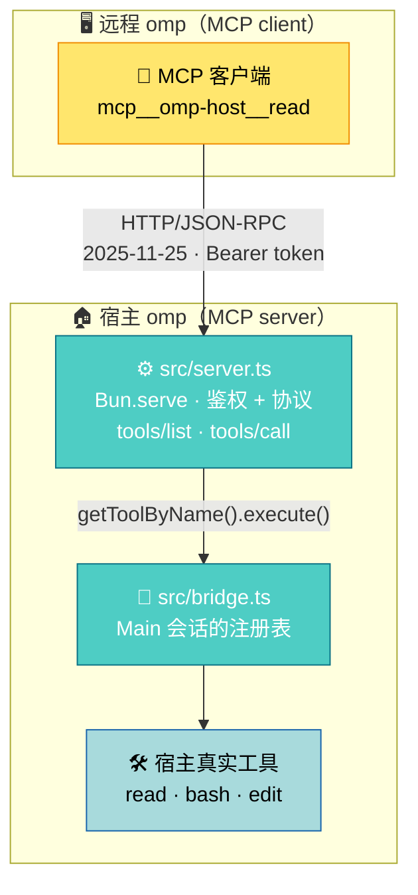

# a2mcp

[English](README.md) | 简体中文

这是一个 omp 扩展。装上之后，本机跑着的 omp 会多开出一个 MCP 接口（MCP 是 agent 调用外部工具的标准协议）：另一个 omp、Claude Code、一段 curl 脚本，任何说 MCP 的程序都能通过它调用这台机器上的工具（`read`、`bash`、`edit`……），命令在本机的 shell 里真跑，文件在本机的磁盘上真改。扩展自己从不请求模型：收请求、跑工具、回结果，推理在调用方那一侧。默认只监听 `127.0.0.1`，跨机器要用 SSH 端口转发接进来。

名字讲的是机制：**a2mcp**，Agent2MCP——一个 agent 的工具面通过 HTTP 交给另一个 agent 用。旧名字里的 A2A 是隔壁那个协议，这里的代码一点没实现它：没有 agent card，没有 task 状态机，没有 `contextId` 和 `taskId`。线上跑的是 MCP `2025-11-25`，语义是「调用方点名工具，宿主执行」。

## 什么时候用哪个

宿主自带 `omp acp`：编辑器（比如 Zed）启动它，把提示词交给它，它自己调模型、自己干活，
结果流回编辑器显示。**要一个能替你干活的本地 agent，用它。**

本桥不干活。发过来的是工具名和参数，桥把它们交给宿主执行，再把结果原样送回——**推理发生在
调用方。** 所以你要的如果是「我自己推理，只借你这台机器的手脚」，用本桥。

两者没法互相替代。`ssh host 'omp acp'` 也不行：那启动起来的是另一个会自己推理的
agent，不是你手上那套模型。

| | `omp acp` | 本桥 |
| --- | --- | --- |
| 谁推理 | omp | 调用方 |
| 传输 | stdio | Streamable HTTP + Bearer |
| 谁连上来 | 代码编辑器 | 任何 MCP 客户端 |

## 工作原理



- 扩展在 `session_start` 时启动 `Bun.serve`，实现 MCP `2025-11-25` 的 `initialize` / `tools/list` / `tools/call`，响应为纯 JSON（无 SSE）。
- 端点是**每进程**一个，而宿主的 `session_start` / `session_shutdown` 是**每会话**一个（task 子代理、ACP 会话、持久化 revive 各有自己一套 handler）。后来的 `session_start` 复用已起的服务器（同时在途的两个只绑一个端点）；`session_shutdown` 只在宿主注册表里没有活的 `Main` 会话时才释放端口（宿主把 `AgentRef.session` 注释成「parked/aborted 时恰为 null」，而 `tools/call` 本来就拒绝那个状态），否则任何一次子代理结束都会把还在服务的端口拆掉。若那个事件落在绑定完成之前，它手里还没有端口可停，于是绑定的那一方完成后回头看一眼注册表：`Main` 没了就把刚绑上的端口收掉。释放用的是非强制的 `stop()`：监听立刻关、新建连接一律被拒，而已经在处理的那一次照常跑完并落审计——强制切断会让 `tools/call` 少一行 `done`。
- 目录、暴露门与执行读同一份注册表：宿主的 `Main` 会话（`getAllToolInfos()`，宿主也正是用它接出 `pi.getAllTools()`），执行随后就在同一个会话上按 `getToolByName` 解析名字。没有活的 `Main` 时（parked/aborted，端口尚未释放那一段），目录退回绑定它的那套 runner 自己的视图，而不是报出一份宿主其实并没有的空注册表。
- 目录就是宿主注册表本身，加上桥自己的三个 `xfer_*` 工具，不增不减（见「安全与边界」）。
- 桥自己从不请求模型：一次远程调用就是「收请求 → 跑工具 → 回结果」。但执行落在宿主的真实会话里，工具留下的会话级副作用可能唤醒宿主自己的 agent，那次推理花的是宿主的 token（见「安全与边界」）。宿主能不能自己推理，这件事本身也归远程接管：见「宿主推理接管」。

## 安装

两条路，分界在机器上有没有 `omp`。已有宿主就只装扩展那一条命令；新机器走一键脚本，它先装宿主，再执行同一条命令。

### 已有 omp：装扩展

```sh
omp install https://github.com/adam-ikari/a2mcp.git
```

卸载：

```sh
omp plugin uninstall a2mcp
```

从 v0.3.0 或更早升上来的先退旧名——插件记账按包名落，新旧两个入口同时在登记里时宿主两个都加载：

```sh
omp plugin uninstall pi-a2a-ext
```

退掉旧名后配置文件与 token 都是新生成的，远程那份 `mcp.json` 要重抄一遍。

URL 必须是完整的 `https://….git`：`owner/repo` 简写被当作非法包名，`.tgz` 报 `ENOTDIR`。

### 一键安装（全新机器）

**Linux**

```sh
curl -fsSL https://raw.githubusercontent.com/adam-ikari/a2mcp/HEAD/scripts/bootstrap.sh | sh -s -- --dry-run   # 只看计划
curl -fsSL https://raw.githubusercontent.com/adam-ikari/a2mcp/HEAD/scripts/bootstrap.sh | sh
```

**macOS**（与 Linux 相同）

```sh
curl -fsSL https://raw.githubusercontent.com/adam-ikari/a2mcp/HEAD/scripts/bootstrap.sh | sh -s -- --dry-run   # 只看计划
curl -fsSL https://raw.githubusercontent.com/adam-ikari/a2mcp/HEAD/scripts/bootstrap.sh | sh
```

**Windows**（PowerShell，在内存里跑，脚本不落盘）

```powershell
& ([scriptblock]::Create((iwr -UseBasicParsing https://raw.githubusercontent.com/adam-ikari/a2mcp/HEAD/scripts/bootstrap.ps1).Content)) -DryRun
& ([scriptblock]::Create((iwr -UseBasicParsing https://raw.githubusercontent.com/adam-ikari/a2mcp/HEAD/scripts/bootstrap.ps1).Content))
```

脚本三步：PATH 上没有 `omp` 就按钉住的版本跑官方安装器；再执行上面那条 `omp install`——扩展的安装始终只有那一条；最后用宿主自己的 `omp plugin doctor` 收口。其余开关：`--upgrade` 才重装宿主，`--reinstall` 强制重登记，`--uninstall` 只收登记（token 与审计留着），`--host-version <版本>` 自定钉值且一次请求都不发。宿主默认在启动时自查更新——「按钉值装上」不等于「一直停在钉值」。它只在「自己装了宿主且 `~/.omp/agent/models.yml` 不存在」时写一份占位模型配置（create-only，PATH 上已有宿主的机器什么都不写；为什么需要它，见「故障排查」）。

两条路装完是同一个样子。启动宿主，通知栏显示：

```
a2mcp listening on http://127.0.0.1:<port> (token <前6字符>…)
```

`<port>` 是实际监听端口（默认随机）。配置与 token 由桥自行生成，每台机器无需额外设置；零模型配置的机器照常起，桥自己补占位模型（见「故障排查」）。

## 配置

配置文件 `~/.omp/agent/a2mcp.json`，首次启动自动生成，权限 `0600`（创建时即 0600，无权限窗口）：

```json
{ "port": 0, "token": "<base64url 32B>", "host": "127.0.0.1", "host_llm": "allow", "xfer": { "dufs": "dufs", "cloudflared": "cloudflared" } }
```

| 字段 | 含义 |
| --- | --- |
| `port` | `0` = 随机端口；写具体数字则固定 |
| `token` | Bearer token，首次启动自动生成（43 字符）；手写短于 32 字符的会被拒绝 |
| `host` | 监听地址，默认 `127.0.0.1`（改成 `0.0.0.0` 会额外告警） |
| `host_llm` | `"deny"` \| `"allow"`（默认）：宿主启动时自己的会话能不能发模型请求，见「宿主推理接管」。它只决定**启动状态**；桥跑起来之后，远程一侧随时可以用 HTTP 切换，与这里写的是什么无关 |
| `xfer.dufs` | 服务共享路径的 HTTP 文件服务器，默认 `dufs`：先查 PATH，查不到就按钉死的版本拉一份构建，装进桥自己的安装目录（POSIX 是 `~/.local/bin`，Windows 是 `%LOCALAPPDATA%\a2mcp\bin`）。写的值里带 `/` 或 `\` 就当作路径直接用，桥一次都不下载。见「传文件」 |
| `xfer.cloudflared` | 发布隧道的二进制，默认 `cloudflared`：查找和下载的规则同 `xfer.dufs`，本文写作时钉的是 2026.10.1 |

只有这些字段：上面的四个顶层字段，加一个可选的 `xfer` 块。**没有工具白名单或黑名单，没有文件沙箱**——桥不替宿主做权限决定，配置里加这些字段不会生效（多余字段被忽略）。`host_llm` 也不在此列：它管的不是调用方能执行什么（那由 token 和宿主自己的工具权限决定），是宿主自己能不能推理。

环境变量 `A2MCP_CONFIG` 可覆盖配置文件路径；`A2MCP_AUDIT` 可覆盖审计日志路径；`A2MCP_INSTALLS` 可覆盖桥记录「自己装过哪些二进制」的位置。

校验是 **fail-closed** 的：字段类型非法（`port` 非整数/越界、`host` 非非空字符串、`token` 短于 32 字符或含空白、`host_llm` 不是 `deny`/`allow` 之一）时扩展拒绝启动并报错。唯一的例外是**缺失**的 `token`（或根本不是字符串）：自动生成并**写回配置**，保证跨重启稳定。谁手写进去的 token 不会被桥换成桥自己生成的那一个——那会让远程 `mcp.json` 对不上号，且没有任何地方说明原因。下限压在 `generateToken` 的产出（43 字符）之下，它拦的是占位符，不是从别处抄来的密钥。

配置文件的改动在**下次重启宿主**后生效；运行中只想换 token 用 `/a2mcp rotate`（立即生效，旧 token 即刻作废）。

### 命令

宿主会话内：

- `/a2mcp` — 显示当前监听地址、端口与 token 前缀
- `/a2mcp rotate` — 轮换 token（写完配置后需同步更新远程 `mcp.json`）
- `/a2mcp token` — 打印完整 token（状态行只显示前缀）

## 远程连接示例

远程 omp 的 `mcp.json`：

```json
{
  "mcpServers": {
    "omp-host": {
      "type": "http",
      "url": "http://127.0.0.1:<port>/",
      "headers": { "Authorization": "Bearer <token>" }
    }
  }
}
```

连上后远程侧会看到 `mcp__omp-host__read`、`mcp__omp-host__bash` 之类的工具，直接调用即可。

## 给远程 agent 的提示词

远程 agent 会拿宿主的工具当自己熟悉的同名工具来调，而 `tools/list` 回的是宿主注册表逐字——这台机器的 `edit` 是补丁语法（`[PATH#TAG]` 加 `PUT N.=M:`），不是 `oldString`/`newString`，猜错换来的是 `File not found`。把下面这段放进它的会话或系统提示，`<port>`、`<token>` 与工具前缀按 `mcp.json` 里的名字替换。

```text
你通过 MCP 服务 omp-host 拿到了另一台机器（下称宿主）的工具。

- 这些工具在宿主上真执行：bash 在宿主的 shell 里跑，read/write/edit 读写宿主磁盘上的文件。路径是宿主机的路径，不是你运行环境的路径——拿不准就先 bash 看 $HOME 和 pwd。
- 工具清单与每个工具的 schema 以 tools/list 为准，宿主当前开了哪些就有什么。调用前先读那个工具的 schema，它与你在别处用过的同名工具不一定同形。
- 宿主不发模型请求，也没有 agent 替你干活：bash/read 返回什么就是什么，推理在你这边。
- 宿主可能给某些工具配了审批；宿主无交互界面时这类调用会一直挂着而不是报错。给每次调用设一个超时。
- 能一条命令说清的事，别拆成一串来回。
```

## 跨机转发

默认只绑回环，不对外网开放。远程机做 SSH 端口转发：

```sh
ssh -L <localport>:127.0.0.1:<port> user@host
```

`mcp.json` 的 `url` 写 `http://127.0.0.1:<localport>/`。

## 审批

远程调用完全复用宿主的审批门（`ExtensionToolWrapper`），不额外开权限：

- 宿主默认 `approvalMode` 为 `yolo` → 直通，没有审批环节。
- 若宿主把某个工具在 `tools.approval` 配成 `prompt`，且宿主有交互 UI（TUI），远程调用会弹 Approve/Deny，用户确认后继续，结果原路返回。
- 宿主无交互 UI 时（rpc 模式实测；print 同为无 UI 路径，未实测），`prompt` 类审批**不会执行命令，但也不返回**：请求一直挂起（实测 ≥90s），宿主在等一个永远不会出现的 UI 应答。**调用方必须自设超时**；挂起的调用会在审计日志留下 `start` 记录而无配对的 `done`（见下），可据此发现。

## 宿主推理接管

实测的唤醒链（见「安全与边界」）说明了同一件事的另一半：宿主会话会在没人要求的时候花掉自己的 token。接管开关把这个决定交到持 token 的人手里。

**`deny` 的含义是宿主自己的会话发不出任何模型请求。** 三层，分工按「每条推理请求最后从哪个口出去」划（判据读自宿主自己的代码）：

- **deny API + 宿主当前持有的模型行**：`a2mcp-deny` 注册成一个只计数、只失败的实现，宿主 agent 手里那一行换成同一行的 deny 副本。宿主自己那一轮因此在建请求之前就被拒：一次尝试、一次 stderr 行、错误 `a2mcp takeover: host inference is disabled in this mode`。这段文本不命中宿主的任何重试触发条件——真实宿主上实测，被拒的一轮只发起一次尝试，以 `retryable: false` 结束。deny 副本不带凭据解析器，所以被拒的一轮连 provider 的取密钥程序都不会跑。
- **按目的地的绊线**：宿主进程的 `globalThis.fetch` 包一层，URL 主机名匹配模型配置里任一 `baseUrl` 的请求一律拒绝。pi-ai 取 fetch 的顺序是 `options.fetch ?? globalThis.fetch`，取的是全局绑定、每次调用现读，所以这层盖住所有走 fetch 的推理请求，包括自建注册表的调用者（task 子代理、web 搜索、commit 消息）。
- **只声明不得不声明的两个 provider**：有两条道不是 fetch——cowork 道（`anthropic` + `anthropic-messages` 时宿主换 `node:https` 直连）和 Codex 的 websocket 道（`api: openai-codex-responses`，宿主把 `providers.openaiWebsockets` 逐次转发给 provider 调用）。这两者的 provider 名字被放到 deny 后面；默认装法下是七十多个 provider 里的 2 个。

**为什么不是「每个 provider 都影子化」。** 宿主的 `registerProvider(name, …, sourceId)` 会把 `sourceId` 记成这个名字的所有者，别人已经拥有时先把在位者的运行期状态清掉再接管；而公开 API 里唯一的撤销是「这个扩展卸载了」，不是「撤销那一次调用」。所以全量影子化等于删掉别的扩展注册过的每一个 provider，一次装配删一次、永不恢复——2026-10-13 在真实注册表上实测：一个扩展注册的两行 provider，一次装配/恢复之后变成零行。恢复时桥会拿快照核对被声明的 provider，没回来的逐个点名。

降噪层把会让宿主自己忙起来、说个不停的设置按住（长命令自动转后台、宿主侧重试、advisor、TTSR、prewalk、autolearn、cache warming、自动压缩），全部是运行时 override，不落盘。实测：接管在位时，一条远程 3 秒 `bash` 跑完就结束，不会变成后台任务。

**归谁控制。** 配置里的 `host_llm` 只决定启动状态（缺省 `allow`）。运行中用 `POST /host-llm` 带 `{"enabled": false}` 装 deny，带 `{"enabled": true}` 按 takeover 的快照恢复（deny API 注销、被声明的 provider 恢复、原始模型行放回、fetch 引用还原、settings overrides），回包是 `{enabled, denied, degraded}`。鉴权与其他路径同一个 Bearer token，每次切换写一条 `tool: "host_llm"` 审计；装配被拒也写一条（`sid: null`，因为没有调用方），外加宿主 stderr 一行——提示条会滚走，审计不会。这个端点刻意**不是**工具：`tools/list` 保持宿主注册表原样。`/a2mcp` 显示当前状态（`host_llm=deny denied=2`）。切换从不落盘，重启回到操作员的配置。装配在每一次 `session_start` 重装（配置里的 `deny` 与远端打开的 deny 都一样）：会话重建会带一份没被影子化的新注册表出来，而端口开着说明不了注册表的状态。装例行把声明的 provider 名字打出来（`takeover armed: 2 provider(s) shadowed (anthropic, openai-codex), …`）——声明是把名字从原主人手里拿走，注册表还不回去，操作员看得见的只有这一行。

**降级。** 开关开着时的拒绝与启动时的拒绝不是一回事。开关仍开着、进程级的绊线仍在，但当前活着的那会话没拿到 deny 行、也没拿到声明，于是它的两条非 fetch 道是裸的。这时回包带 `degraded: true`，`/a2mcp` 显示 `host_llm=deny (tripwire only)`，stderr 与审计各留一行。拒绝检查排在恢复旧会话**之前**就是为了这个：先恢复再拒绝，等于在失败的路上顺手把绊线也拆了。

**它放弃了什么，什么在承诺之外。**

- `transport`（`pi-native` 及任何在 API 分派之前短路的 transport）在宿主内部先于扩展注册的任何实现分派，桥排不到它前面。配置里有这样一个**不在被声明名单里**的 provider 时 takeover **拒绝装配**：错误可见，绝不半装。真需要 deny 的地方，改的是配置，不是桥。
- 被声明的那两个 provider 若本来就是某个扩展运行期注册的（不是 `models.yml` 里配的），恢复之后那份注册不会回来——撤销原语没有这个能力。恢复时点名，要回来得重启宿主。
- 不走 `globalThis.fetch` 的请求，桥管不着。注册表在构造时捕获了自己的 fetch，于是宿主的目录与元数据 GET（模型列表、目录刷新）出得去——**即使那个主机名就在绊线键里**。实测每轮接管探针的 sink 收到一次非 POST，收尾行与推理 POST 分开打印。非推理出口不拦是设计如此，但「键内的主机一定被拒」这句话不成立。
- 绊线盯的是宿主进程。`bash` 工具里的 `curl` 跑在别的进程里，`deny` 不是网络沙箱，也不自称是。（实测：deny 状态下 task 子代理的请求在 fetch 边界被拒，一次本地拒绝，不出网。）
- 桥运行期间往 `models.yml` 新增的 provider，要等下一次装配才进快照、才被绊线盯上；`/login` 把模型所有权交回宿主，被声明的 provider 影子随之失效。
- 接管期间宿主把模型行换回真行也没用，它落在绊线上；但恢复时桥不会把它换回 deny 副本——那是操作员的选择。
- `title.generator` 的枚举里没有关（只有 `fork | tiny`），宿主仍会尝试生成会话标题；这些尝试在 deny 层失败关闭，错误通知可能出现在会话里。
- 被拒的轮次仍然是轮次：宿主会话历史里会留下一条错误消息。接管限制的是宿主能做什么，不是它记得什么。

## 传文件

传文件走普通 HTTP：`xfer_share` 把一条宿主路径交给 `dufs`（[sigoden/dufs](https://github.com/sigoden/dufs)，单文件静态二进制），由 cloudflared quick tunnel 发布成公网主机名。桥自己不提供字节协议，字节不经过 JSON-RPC。

`xfer_share` 收 `{ path, ttlSeconds? }`——要服务的文件或目录——返回一个内嵌 HTTP basic auth 凭据的 URL（`https://omp:<secret>@<random>.trycloudflare.com/`）、本地端口与到期时间。下行 `curl -u omp:<secret> -O <host>/<name>`，上行 `curl -u omp:<secret> -T <local> <host>/<name>`；Range 请求续传，WebDAV 客户端可用。共享在 TTL（默认 3600 秒）到期、收到 `xfer_stop`、或桥停止时关闭；第二次 `xfer_share` 顶掉前一次。

`xfer_status` 与 `xfer_stop` 不收参数。

**这个 URL 就是一份能力**：谁拿着它，谁就能读、能写那条路径，直到共享关闭。

前置的两个二进制，桥自己找：先查 PATH，查不到就拉一份钉死版本的构建，装进桥自己的安装目录（POSIX 上是 `~/.local/bin`，Windows 上是 `%LOCALAPPDATA%\a2mcp\bin`），用它起服务。两个都钉版本号加 sha256，写在 `src/obtain.ts`：`dufs` 是 0.46.0，`cloudflared` 是 2026.10.1，各有 `linux-x64`、`linux-arm64`、`darwin-x64`、`darwin-arm64`、`win32-x64` 五行，每一个哈希都由 `bun run test:obtain` 对着 GitHub 实际下发的字节复验过。桥不要 `latest`，也不向递给它字节的那台服务器要校验和。

`win32-arm64` 没有那一行，原因在上游：`dufs` 发 aarch64 的 Windows 构建，`cloudflared` 不发，Windows on ARM 的机器会拉到一半、在另一半上失败。桥在那里报的是缺哪一对，不是装半个。

Windows 那两行是这里最新、也最少被量过的东西。查到的：asset 的 URL 应答、zip 在这台机器上算出来与表里写的哈希一致、zip 里那一个条目能用 Windows 主机将要调的那段代码读出、`.exe` 是 PE 且没超下载上限——都在 `bun run test:obtain` 里。没查到的：它跑起来。写这几行的时候没有 Windows 机器在场，所以 Windows 上的第一次 `xfer_share` 也是这些字节第一次执行。

拉取是桥多出来的一个意见。它先前已经决定用 `dufs` 当文件服务器，这次只补一句「字节从哪来」。出口是写路径：`xfer.dufs` 写成 `"/srv/bin/dufs"`，桥就拿这个文件用，一次都不下载；Windows 的路径带反斜杠，判据是「值里出现 `/` 或 `\`」。写裸名字就是让它去找，找不到就去拉。别人放的文件桥不动：`~/.local/bin/dufs` 已经存在、又不是自己装的那一份，桥拒绝继续，并把它的 sha256 打出来。自己装过什么，记在 `<agentDir>/a2mcp.installs.json`。

需要拉取的共享会等拉完，回包用 `installed` 说清拉的是哪个版本，本来就在的地方是 `null`。每次调用一条审计，`tool: "xfer"`，拉取那几次是 `action: install`。

## 设备

设备在宿主那边有两种形态，桥都原样透传。

**工具链（`bash`）**。`adb`、`idf.py`、串口工具、烧录器都不是 omp 的工具，是本机上的命令。`bash` 在 `tools/list` 里，于是远程直接跑：

```json
{ "jsonrpc": "2.0", "id": 1, "method": "tools/call",
  "params": { "name": "bash", "arguments": { "command": "adb devices -l" } } }
```

执行落在本机的 shell，PATH 上有什么就有什么——装了 Android SDK 就调得到 adb，ESP-IDF 装了就能 `idf.py flash`。端口监视、寄存器读写同理。

**挂载设备（`xd://`）**。宿主把工具挂成虚拟设备，**它们不在 `tools/list` 里**，而是通过 `read` / `write` 的 `path` 参数驱动：

```json
{ "name": "read",  "arguments": { "path": "xd://" } }              // 列出挂载的设备
{ "name": "read",  "arguments": { "path": "xd://debug" } }         // 取该设备的文档与 JSON schema
{ "name": "write", "arguments": { "path": "xd://debug", "content": { … } } }  // 执行
```

清单由宿主运行时决定——装了哪些扩展、接了什么设备，就有什么。本机实测挂载的是 `xd://debug`（DAP 调试器）、`xd://lsp`、`xd://ast_edit`。

**`tools/call` 直接叫 `xd://` 会被拒**（`not exposed`）：设备不是独立工具名，只有 `read` / `write` 的 `path` 能到达。这是宿主的形态，桥不改写它。

## 安全与边界

- **token 即工具执行全权（默认配置下）**：宿主默认 `approvalMode: yolo`，拿到 token 就可在宿主会话里直接执行任意暴露的工具（含 `bash`），不经过任何审批；只有宿主把工具配成 `prompt` 才有审批门可拦（无 UI 时见审批节）。配置文件保持 `0600`，不要进版本库。
- **桥不做权限决定**：`tools/list` 是宿主 `Main` 会话的注册表（`getAllToolInfos()`），原样透传、不过滤，外加桥自己服务的三个 `xfer_*`。因此它包含 `hidden` 工具、也包含宿主当前对自己模型禁用的工具——**omp 是什么权限，桥就是什么权限**。桥没有 `deny` 这类第二套名单：两份名单可以互相矛盾，而代码里没有定义谁优先。要收紧就配宿主自己的工具权限，桥不参与。
- **执行走宿主原生工具**：`tools/call` 固定路由到宿主 `Main` 会话的 `getToolByName().execute()`，注入真实的 `session.settings` 与 `ExtensionContext ui`，所以宿主的审批门（`ExtensionToolWrapper`）照常生效，桥自己一套审批逻辑都没有。三个 `xfer_*` 工具是例外：桥自己分派它们（见「传文件」），不进 `getToolByName()`，也不过那道门——持 token 的人能把桥能读到的任意路径发布到公网，中间没有审批；拿到那个 URL 的人还能改写它。
- **远程调用可能唤醒宿主自己的 agent**。桥自己一次模型请求都不发，但执行归宿主管：一条远程 `bash` 超过宿主的命令超时（实测默认 300 秒），宿主把它转成后台任务，任务完成时往会话里注入一条完成通知（"Background job … has completed. Resume your work…"），宿主会话自己的 agent loop 就从这条通知醒过来，开始推理、跑它自己的本地工具。Windows 宿主上实测的链条：调用超时转后台（04:35:23）→ 完成通知进会话（04:36:27）→ 宿主第一批带 usage 的 assistant 消息（04:36:31，模型 stack/medium，单轮输入从 8,309 token 起），此后几十轮。这不是桥在推理，是工具执行在宿主会话里留下的后果，花的是宿主的 token。宿主这一半是开关，不是既成事实：接管在位时（`host_llm: "deny"` 或 `POST /host-llm`），被唤醒的会话发不出任何模型请求——见「宿主推理接管」。
- **调用与列表同源**：`tools/call` 只接受出现在 `tools/list` 里的名字，别名（如 `xd://bash`）和未注册的名字一律拒绝，且不区分「被过滤」与「不存在」（不泄露名字是否存在）。
- **`POST /host-llm` 是桥不属于工具的那条路。** 它直接伸手进宿主会话——换注册表行、override 设置、替换进程的 `fetch`——桥在这里有了自己的意见，绕开了宿主的工具分发，代价是审计（`tool: "host_llm"`，每次切换一条）和文档。它限制的是宿主自己的推理，且只听从握着 token 的人的指令。见「宿主推理接管」。
- 默认仅回环监听；真要对外暴露，防火墙自己负责。
- **会话强制**：除 `initialize` 外所有消息必须携带 `Mcp-Session-Id`（缺失 → 400，未知/空闲超 24h → 404）。会话上限 64 个，超出淘汰最久未用；每次命中刷新空闲计时。
- **审计日志**：每次远程 `tools/call` 写两条 JSONL——发起时 `{ts,id,sid,phase:"start",tool,args}`，完成时 `{ts,id,sid,phase:"done",tool,isError,args}`（同 `id` 配对；`sid` 为该调用的 `Mcp-Session-Id`，共享 token 下可把调用归因到客户端会话；参数摘要截断 1KB）到 `~/.omp/agent/a2mcp.log`，权限 0600，超过 512KB 轮转为 `.1`。这里的 `id` 是本桥为配对生成的 UUID，调用方的 JSON-RPC id 不落日志，所以按 JSON-RPC id 查不到。参数里超过 120 字符的字符串只记 `<len:N,sha256:前8位>`，日志不落载荷，且**不分嵌套层数**：宿主 `edit` 的文件正文就落在 `args.edits[0].oldText`（第三层），只走两层的脱敏会把它原样写出去。嵌套超过 32 层整个子树换成 `<max-depth>`，不再往下走。这里说的是桥自己这份日志；宿主会话照常收到那些参数，宿主自己的记录归宿主管。记录按进程内一条队列落盘，因为「查大小 → 轮转 → 写行」是三步而不是一个整体：两个并发写都读到越过上限的尺寸就会都去轮转，第二次 `rename` 覆盖掉的正是第一次刚放好的那个 `.1`。不串行时同一份代码重跑六轮，最坏的一次两个文件各剩 1 条记录——测试摆到磁盘上的 572 条里有 570 条在两个文件都找不到；最轻的一次是并发那 60 条只剩 1 条。日志写失败不影响调用，但也不无声吞掉：每个日志路径的头一次写失败会往宿主 stderr 打一行 `[a2mcp] audit record not written to <路径>（<原因>）`，此后每满一百次再打一行——写不成的日志与从没被调用过的桥看起来一模一样。`start` 排在工具执行之前、`done` 排在响应发出之前，两者都要落盘了请求才走：拿到 200 就意味着那一行已经在盘上，接着读日志不必轮询。这一条以前是反的（落盘走进程内队列、调用方不等它），而且只在磁盘慢到队列排得上时才显形，实测代价是每条记录约 99 µs（`stat` + `appendFile` + `chmod`，串行），对着一次 bash 调用可以忽略。未鉴权的尝试在这份日志里一条不写——走宿主 stderr，第一次与其后每五十次各一行——写审计就要驱动轮转，这个杠杆不该交到还在猜 token 的人手里，少记那几行的损失没有它大。
- **只有 `start` 没有 `done` = 调用已发起但未完成**（典型：无 UI 下挂起的审批）。读这个信号有两处坑，都实测过：轮转可能把一次调用的两条分处 `.1` 与当前文件，所以要在两个文件里按 `id` 配对；而且只保留一代——下一次轮转会覆盖 `.1`，挂起调用的证据会被后续流量冲出日志。要在它还在的时候读。
- 端口被占用时回退到随机端口并告警（远程 `mcp.json` 需同步改端口）。

与 computer use（看屏幕猜坐标点按）的差别见 [docs/computer-use.md](docs/computer-use.md)。

请求/响应格式、处理顺序、会话生命周期与错误码总表的完整 wire 契约见 [docs/protocol.md](docs/protocol.md)。

在线文档站（GitHub Pages，push 自动发布）：<https://adam-ikari.github.io/a2mcp/>

v1 边界：

- 只暴露工具（`tools/list` + `tools/call`），无 resources、无 prompts。
- 无 SSE 推送，无调用取消。
- 固定路由到宿主 `Main` 会话。
- 静态 Bearer token，无 OAuth。
- 无并发/速率限制。

设计取舍（想加功能前先看这段）：

- 桥只负责把调用送到，不在途中加意思。宿主已有 `read`/`bash`/`edit` 就能表达的能力，不另造工具；不替宿主判断路径；不按权限过滤目录——**omp 是什么权限，桥就是什么权限**。给桥加一份自己的判断，它就成了第二个 omp。
- 桥自带的工具会绕过宿主审批门，因此必然要自带沙箱。**这是一个决定的两个后果，要一起删**：只删沙盒会留下谁都不管的洞。


## 故障排查

- **一台没有任何模型配置的机器第一次启动**：宿主照样创建 session，桥在 `session_start` 注册一个占位 provider `a2mcp/offline` 并切换到它。它的 baseUrl 指向 `a2mcp.invalid`（RFC 6761 保留域），永远解析不到；整个过程是运行态，不写文件，也不抢操作者已经选好的模型——slot 是空的它才动。MCP 面因此开箱即用：通知栏照常广播，远程 `initialize`、`tools/list` 照常回 200。占位模型不做推理。在宿主上发 prompt 会得到连接被拒的软失败，18.12.1 实测报的是 `Couldn't connect to a2mcp.invalid (connection refused)`；真推理永远要自己 `/login`、`/model`。更早的宿主在这种机器上停在 `No model selected`（再早是 `No models available`），那是提示时刻的闸门，升级宿主即可。无头启动（`omp --mode rpc`）到不了这一步：宿主死在扩展代码运行之前，救它只能在开机前把 `~/.omp/agent/models.yml` 放到磁盘上。一键安装脚本正是在这个条件下写这份文件：只有脚本自己装了宿主、且该文件不存在时（create-only，已存在的文件一个字不碰，PATH 上本来就有宿主的机器什么都不写）。手工装的宿主想要无头启动，照 `docs/protocol.md` 的占位模型一节写。探针天天在跑的就是这份不可达占位形状，Linux 与 macOS 实测过；Windows 上脚本本体 2026-10-19 头一回真跑（宿主已在的那一支），而写 `C:\Users\<user>\.omp\agent\models.yml` 的播种那一支在那台机器上还没有执行过。
- **401 `unauthorized`**：token 不匹配。远程 `mcp.json` 的 `Authorization` 头必须与配置 `token` 一致；`/a2mcp rotate` 之后要同步改远程侧。宿主 stderr 会在第一次失败以及此后每五十次打一行 `[a2mcp] N unauthorized attempt(s)`；这些尝试刻意不进审计日志（理由见「安全与边界」的审计日志条目）。
- **桥拒绝启动，报 `field 'token' must be at least 32 characters`**：有人往 `a2mcp.json` 里写了个短的 token。放真正的密钥进去，或者删掉该字段让桥自己生成并持久化一个——桥不会替换交到它手里的那份。
- **桥拒绝启动，报 `field 'host_llm' must be 'deny' or 'allow'`**：这个字段被写成了别的值（`"false"`、`"ALLOW"`、布尔量）。它决定接管的启动状态；含糊的值一律拒绝，不猜（见「宿主推理接管」）。
- **takeover 装配失败**（`/a2mcp` 通知、宿主 stderr 里的 `[a2mcp] takeover failed to arm: …`，以及一条带 `error` 的 `host_llm` 审计记录）：模型配置里有落在被声明名单之外的 provider 带 `transport`（`pi-native` 或任何在 API 分派之前短路的 transport），桥排不到它前面，于是拒绝装配，推理照常归宿主自己的规则管。确实需要 deny，就删掉或改掉那个 provider。
- **宿主 stderr 出现 `takeover restore left N provider(s) unregistered … restart the host to recover`**：被声明的那两个 provider 里，有一个本来就是别的扩展在运行期注册的（不是 `models.yml` 里配的），而注册表的撤销原语没法重放别人的注册。deny 本身已经装回去了，缺的只是那个 provider，要回来得重启宿主。
- **审计一条没有、调用也没有失败**：日志路径写不进去——`$A2MCP_AUDIT` 指向不存在的目录、权限不对，或磁盘满。宿主 stderr 里有 `[a2mcp] audit record not written to <路径>（<原因>）`。修好路径拿不回已经丢掉的那些记录。
- **400 `missing mcp-session-id` / 404 `unknown session`**：除 `initialize` 外都要带会话头。会话是宿主进程内存态——宿主重启即全部失效、空闲超 24h 也回收；重新 `initialize` 拿新会话即可（正规 MCP 客户端库会自动处理）。
- **连不上 / 端口对不上**：宿主启动时配置端口被占用会回退到随机端口并在通知栏告警——以通知栏或 `/a2mcp` 显示的实际端口更新 `mcp.json`。
- **调用一直没有返回**：宿主无交互 UI 且该工具审批为 `prompt`（见「审批」）——命令不会执行但也不返回；调用方必须自设超时，审计日志里该调用只有 `start` 没有 `done`（见「安全与边界」的审计日志条目）。
- **500 `internal error`**：服务端内部故障；响应体固定不含细节（防泄露），真实原因在宿主 stderr，形如 `[a2mcp] internal error: …`。
- **改了配置不生效**：外部编辑 `a2mcp.json`（如 `port`）需重启宿主；运行中只有 `/a2mcp rotate` 即时生效。
- **`bun test` 版本守卫失败**（开发）：两种可能——`@oh-my-pi/pi-*` 实装与 pin/lock 失同步（`bun install` 恢复），或本机 `omp --version` 与 pin 不一致（升级宿主时同步改 `package.json` 里的两个精确版本号）。宿主那一半此前只告警，pin 于是可以无人察觉地漂移；现在会失败，只在 `PATH` 上没有宿主时跳过。确实要对着别的宿主版本跑，用 `A2MCP_SKIP_HOST_VERSION_CHECK=1`，会打一行大声的 SKIPPED，不静默放过。

## 开发

```sh
bun install

bun run typecheck     # 类型检查
bun run lint          # lint + 格式检查（Biome；修复用 bunx biome check --write .）
bun run test:tree     # 仓库形状：没有符号链接指向本机之外，3 项，无依赖、无需本机 omp（排在 bun test 之前是故意的）
bun test              # 单测：test/*.test.ts（226 项：协议/鉴权/配置/暴露门/宿主交接/入口生命周期/审计/版本守卫/takeover 形状/装配事务/host-llm 路由/xfer/obtain 的形状含 win32 那几处/占位模型/两份引导脚本对不对得上）
bun run test:obtain   # 钉死的两个二进制：本机这一行真下载、钉表十个 asset 全 HEAD、Windows 那两行按字节读，37 项（不需要本机 omp；只往它自己那个 /tmp 目录里写）
bun run test:registry # 真实模型注册表上驱动接管，28 项，秒级（不需要本机 omp，也不需要凭据）
bun run test:smoke    # 真实 E2E（需本机 omp；不需要模型凭据）
bun run test:hardening # 真实宿主加固核验，34 项（需本机 omp）
bun run test:approval  # 审批边界判别核验，约 95 秒（需本机 omp）
bun run test:takeover  # 宿主推理 deny/restore 对一个计数 sink 实测，约 60 秒（需本机 omp）
bun run test:scenario  # 端到端场景，8 个叙事 / 41 步，约 45 秒（需本机 omp）
bun run test:install   # 发布包自包含 + 真实宿主走 MCP，48 项（需本机 omp；会向 GitHub 拉约 46 MB）
bun run test:bootstrap # 一键脚本的判断核验，46 项，约 9 秒（除最后一组都用自制的记账 stub omp 加一只记录 argv 的假 curl；最后一组需本机 omp）
bun run website        # 文档站（VitePress）本地预览，端口见输出（5173 起，被占则顺延）；首次先 cd website && bun install
```

各测试的覆盖面、真实宿主核验的前置条件与判读标准（含审批核验 VERDICT A/B/C 语义）见 [docs/testing.md](docs/testing.md)。

依赖说明：`@oh-my-pi/pi-coding-agent` 与 `@oh-my-pi/pi-ai` 以**精确版本**固定在 `devDependencies`，与宿主 omp 版本保持一致，仅用于类型检查与单测。**运行时不要从 `node_modules` 加载它们**——宿主 omp 的 `omp:legacy-pi-shim` 会把这些 import 重定向到宿主内嵌的同一份模块，`AgentRegistry.global()` 这类模块级单例才能共享；升级 omp 时同步改这两个版本号；`bun test` 内置**版本守卫**：实装 devDep ≠ pin 直接失败，本机 `omp --version` ≠ pin 时同样失败（那一半此前只告警，而没人必须处理的告警不是守卫）。

文件布局：

| 路径 | 职责 |
| --- | --- |
| `extensions/a2mcp.ts` | 扩展入口，`session_start` 起服务器，注册 `/a2mcp` |
| `src/server.ts` | `Bun.serve` + JSON-RPC（MCP 2025-11-25，纯 JSON 响应）、会话与版本协商 |
| `src/bridge.ts` | 工具目录与执行（都走 AgentRegistry 的 `Main` 会话，入口那份 `pi.getAllTools` 只在没有活的 Main 时兜底）、暴露交集判定 |
| `src/config.ts` | 配置加载/保存、字段校验、token 生成 |
| `src/auth.ts` | Bearer token 校验（timing-safe 比较） |
| `src/audit.ts` | 远程调用审计日志（JSONL 两阶段 `start`/`done`，轮转） |
| `src/takeover.ts` | 宿主推理接管：deny api 与宿主当前模型行、按目的地 fetch 绊线、只声明非 fetch 道的 provider、降噪 overrides、快照与恢复 |

变更历史见 [CHANGELOG.md](CHANGELOG.md)。

## 许可

MIT，见 [LICENSE](LICENSE)。
