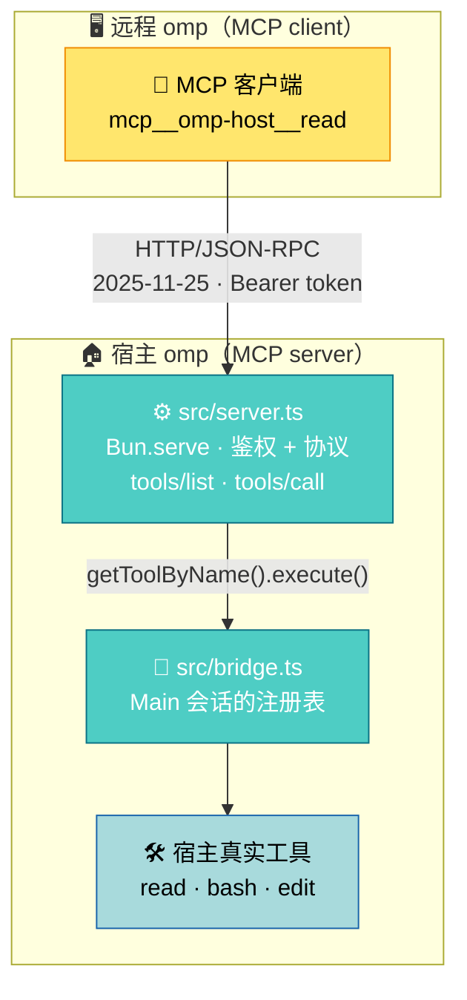

# a2mcp

[English](README.md) | 简体中文

这是一个 omp 扩展。装上之后，本机跑着的 omp 会多开出一个 MCP 接口（MCP 是 agent 调用外部工具的标准协议）：另一个 omp、Claude Code、一段 curl 脚本，任何说 MCP 的程序都能通过它调用这台机器上的工具（`read`、`bash`、`edit`……），命令在本机的 shell 里真跑，文件在本机的磁盘上真改。扩展自己从不请求模型：收请求、跑工具、回结果，推理在调用方那一侧。默认只监听 `127.0.0.1`，跨机器要用 SSH 端口转发接进来。

名字讲的是机制：**a2mcp**，Agent2MCP——一个 agent 的工具面通过 HTTP 交给另一个 agent 用。旧名字里的 A2A 是隔壁那个协议，这里的代码一点没实现它：没有 agent card，没有 task 状态机，没有 `contextId` 和 `taskId`。线上跑的是 MCP `2025-11-25`，语义是「调用方点名工具，宿主执行」。

## 什么时候用哪个

宿主自带 `omp acp`：编辑器启动它，提示词交给它，它自己调模型干活。**要一个能替你干活的本地 agent，用它。**

本桥不干活。发过来的是工具名和参数，桥把它们交给宿主执行，结果原样送回——**推理发生在调用方。** 你要「自己推理，只借这台机器的手脚」，用本桥。

`ssh host 'omp acp'` 顶替不了：那起来的是另一个会自己推理的 agent，不是你手上那套模型。

| | `omp acp` | 本桥 |
| --- | --- | --- |
| 谁推理 | omp | 调用方 |
| 传输 | stdio | Streamable HTTP + Bearer |
| 谁连上来 | 代码编辑器 | 任何 MCP 客户端 |

## 工作原理



- 扩展在 `session_start` 时启动 `Bun.serve`，实现 MCP `2025-11-25` 的 `initialize` / `tools/list` / `tools/call`，响应为纯 JSON（无 SSE）。
- 端点是**每进程**一个，`session_start` / `session_shutdown` 是**每会话**一个。后来的 `session_start` 复用已起的服务器；`session_shutdown` 只在注册表里没有活的 `Main` 会话时才释放端口，否则任何一次子代理结束都会拆掉还在服务的端口。释放用非强制的 `stop()`：新连接被拒，处理中的那一次照常跑完并落审计。整条生命周期由入口生命周期单测守着（`docs/testing.md`）。
- 目录、暴露门与执行读同一份注册表：宿主的 `Main` 会话。目录就是这份注册表本身，加上桥自己的 `xfer_*`（现在三个），不增不减（见「安全与边界」）。
- 桥自己从不请求模型：一次远程调用就是「收请求 → 跑工具 → 回结果」。但执行落在宿主真实会话里，工具留下的副作用可能唤醒宿主自己的 agent，那次推理花宿主的 token（见「安全与边界」）。宿主能不能自己推理，归接管开关管：见「宿主推理接管」。

## 安装

两条路，分界在机器上有没有 `omp`。已有宿主就只装扩展那一条命令；新机器走一键脚本，它先装宿主，再执行同一条命令。

### 已有 omp：装扩展

```sh
omp install https://github.com/adam-ikari/a2mcp.git
```

这条命令落盘的是整棵仓库的检出（实测 2.3 MB，`docs/`、`test/` 都在），桥真正读的只有 `extensions/` 和 `src/`。

卸载：

```sh
omp plugin uninstall a2mcp
```

从 v0.3.0 或更早升上来的先退旧名——插件记账按包名落，新旧两个入口同时在登记里时宿主两个都加载：

```sh
omp plugin uninstall pi-a2a-ext
```

退掉旧名后配置文件与 token 都是新生成的，远程那份 `mcp.json` 要重抄一遍。

URL 必须是完整的 `https://….git`：`owner/repo` 简写被当作非法包名，`.tgz` 的路径或 URL 也不被接受（宿主拿它走 link，报 `ENOTDIR`）。包名形态——`omp install a2mcp`——是预留、不是可用：这个名字没有发到 registry，命令会停在依赖解析。两份引导脚本两种形态都认、按形状取版本钉；包哪天上了 registry，包名哪天可用。

### 一键安装（全新机器）

**Linux**

```sh
curl -fsSL https://raw.githubusercontent.com/adam-ikari/a2mcp/HEAD/scripts/bootstrap.sh | sh -s -- --dry-run   # 只看计划
curl -fsSL https://raw.githubusercontent.com/adam-ikari/a2mcp/HEAD/scripts/bootstrap.sh | sh
```

**macOS**（与 Linux 相同）

```sh
curl -fsSL https://raw.githubusercontent.com/adam-ikari/a2mcp/HEAD/scripts/bootstrap.sh | sh -s -- --dry-run   # 只看计划
curl -fsSL https://raw.githubusercontent.com/adam-ikari/a2mcp/HEAD/scripts/bootstrap.sh | sh
```

**Windows**（PowerShell，在内存里跑，脚本不落盘）

```powershell
powershell -NoProfile -ExecutionPolicy Bypass -Command "irm https://raw.githubusercontent.com/adam-ikari/a2mcp/HEAD/scripts/bootstrap.ps1 | iex"
```

要传开关（`-DryRun` 之类）就用 scriptblock 形态，参数不进被执行的那个字符串：

```powershell
& ([scriptblock]::Create((iwr -UseBasicParsing https://raw.githubusercontent.com/adam-ikari/a2mcp/HEAD/scripts/bootstrap.ps1).Content)) -DryRun
```

脚本三步：PATH 上没有 `omp` 就按钉住的版本跑官方安装器；再执行上面那条 `omp install`——扩展的安装始终只有这一条命令；最后用宿主自己的 `omp plugin doctor` 收口。其余开关：`--upgrade` 才重装宿主，`--reinstall` 强制重登记，`--uninstall` 只收登记（token 与审计留着），`--host-version <版本>` 自定钉值且一次请求都不发。宿主默认在启动时自查更新——「按钉值装上」不等于「一直停在钉值」。它只在「自己装了宿主且 `~/.omp/agent/models.yml` 不存在」时写一份占位模型配置（create-only，PATH 上已有宿主的机器什么都不写；为什么需要它，见「故障排查」）。

两条路装完是同一个样子。启动宿主，通知栏显示：

```
a2mcp listening on http://127.0.0.1:<port> (token <前6字符>…)
```

`<port>` 是实际监听端口（默认随机）。配置与 token 由桥自行生成，每台机器无需额外设置；零模型配置的机器照常起，桥自己补占位模型（见「故障排查」）。

## 配置

配置文件 `~/.omp/agent/a2mcp.json`，首次启动自动生成，权限 `0600`（创建时即 0600，无权限窗口）：

```json
{ "port": 0, "token": "<base64url 32B>", "host": "127.0.0.1", "host_llm": "allow", "xfer": { "dufs": "dufs", "cloudflared": "cloudflared" } }
```

| 字段 | 含义 |
| --- | --- |
| `port` | `0` = 随机端口；写具体数字则固定 |
| `token` | Bearer token，首次启动自动生成（43 字符）；手写短于 32 字符的会被拒绝 |
| `host` | 监听地址，默认 `127.0.0.1`（改成 `0.0.0.0` 会额外告警） |
| `host_llm` | `"deny"` \| `"allow"`（默认）：宿主启动时自己的会话能不能发模型请求，见「宿主推理接管」。它只决定**启动状态**；桥跑起来之后，远程一侧随时可以用 HTTP 切换，与这里写的是什么无关 |
| `xfer.dufs` | 服务共享路径的 HTTP 文件服务器，默认 `dufs`：先查 PATH，查不到就按钉死的版本拉一份构建，装进桥自己的安装目录（POSIX 是 `~/.local/bin`，Windows 是 `%LOCALAPPDATA%\a2mcp\bin`）。写的值里带 `/` 或 `\` 就当作路径直接用，桥一次都不下载。见「传文件」 |
| `xfer.cloudflared` | `/a2mcp tunnel` 用来发布桥端口的隧道二进制，默认 `cloudflared`：查找和下载的规则同 `xfer.dufs`，本文写作时钉的是 2026.10.1。`xfer_share` 不找它，一次共享只需要文件服务器 |

字段就这些：四个顶层字段加一个可选 `xfer` 块。**没有工具黑白名单、没有文件沙箱**——多余字段被忽略，桥不替宿主做权限决定。`host_llm` 例外：它管的不是调用方能执行什么（那由 token 和宿主工具权限决定），是宿主自己能不能推理。

环境变量 `A2MCP_CONFIG`、`A2MCP_AUDIT`、`A2MCP_INSTALLS` 分别覆盖配置、审计日志、桥自己那份「装过哪些二进制」记录的路径。

校验 **fail-closed**：字段类型非法（`port` 非整数/越界、`host` 空、`token` 短于 32 字符或含空白、`host_llm` 不是 `deny`/`allow`）时扩展拒绝启动并报出字段名。唯一例外是**缺失**的 `token`：自动生成并写回配置。手写的 token 桥不会换成自己生成的——那会让远程 `mcp.json` 对不上号且无人说明。32 字符的下限压在生成产出（43 字符）之下，拦的是占位符，不是抄来的密钥。

配置文件的改动在**下次重启宿主**后生效；运行中只想换 token 用 `/a2mcp rotate`（立即生效，旧 token 即刻作废）。

### 命令

宿主会话内：

- `/a2mcp` — 显示当前监听地址、端口与 token 前缀（隧道开着时行尾会带上它的 URL）
- `/a2mcp rotate` — 轮换 token（写完配置后需同步更新远程 `mcp.json`）
- `/a2mcp token` — 打印完整 token（状态行只显示前缀）
- `/a2mcp prompt` — 一块打印远程接入要的东西：远程客户端能用的 URL（隧道开着就是公网那条，关着就是回环那条）、完整 token，以及给远程 agent 的那段英文提示词。URL 与 token 进远程客户端的 `mcp.json`，提示词进 agent。提示词里既没有 URL 也没有 token——token 放进提示词就是把它放进模型的上下文，那比配置文件宽得多
- `/a2mcp tunnel` — 在桥的端口前面起一条 cloudflared 快速隧道，打印公网 URL（`https://<随机>.trycloudflare.com`）。一条隧道只顶一个端口，MCP 端点和开着共享的 `/xfer/` 路由都从它走。运行态，不落配置，见「跨机转发」
- `/a2mcp tunnel stop` — 关闭隧道
- `/a2mcp incognito` — 无痕模式开关。它的意思就是两句：**宿主端 omp 不记录这次调用，桥的审计日志整份静默**——宿主 session transcript 里没有那条，宿主 stdout 的渲染流里也没有那条（两处都是桥发的那对渲染事件写出来的，模式把它们停掉）；桥自己做的别的事（调用、共享、隧道、实例、开关）也一条不记：闸门是 `src/audit.ts` 里的一个开关，所有记录都从那儿写，所以「静默」不会变成「除了某几条恰好接了线的以外都静默」。只剩开关自己那两行，写在静默窗口的外面，于是那段空白说得清是谁关的。工具自己的副作用管不了——命令写了文件，文件就还在。只有操作员够得到这个开关：能让调用方给自己的记录消音的桥，那份日志就不成其为证据。运行态：桥退出即无

## 远程连接示例

远程 omp 的 `mcp.json`：

```json
{
  "mcpServers": {
    "omp-host": {
      "type": "http",
      "url": "http://127.0.0.1:<port>/",
      "headers": { "Authorization": "Bearer <token>" }
    }
  }
}
```

连上后远程侧会看到 `mcp__omp-host__read`、`mcp__omp-host__bash` 之类的工具，直接调用即可。

## 两条接入路

分开两条路的，是你的客户端会不会说 MCP。

**客户端会说 MCP。** 用上面那份 `mcp.json` 接上桥就够了，不要再写一个客户端。宿主的工具原生进你的工具列表，握手、会话头、重连都归 MCP 库管，不归你。

**客户端不会说 MCP，但能跑代码。** 一段被贴进提示词的通用 coding agent、一个 CI 任务、一段非要自己走 `tools/call` 的脚本，取 `scripts/mcp-call.py`，零依赖的 Python 3 参考客户端，经它调桥，不必每次重新推一遍握手。

```sh
curl -fsSL https://raw.githubusercontent.com/adam-ikari/a2mcp/HEAD/scripts/mcp-call.py -o mcp-call.py
python3 mcp-call.py --url http://127.0.0.1:<port>/ --token <token> list
python3 mcp-call.py --url http://127.0.0.1:<port>/ --token <token> schema read
python3 mcp-call.py --url http://127.0.0.1:<port>/ --token <token> call bash '{"command":"adb devices"}'
```

`list` 逐个打印工具名和它描述的第一行；`schema <名字>` 打印那一个工具的整条目录项（名字、描述、入参 schema）——要读一个工具想要什么，不必自己写个客户端去问；`call <名字> <json>` 调一个工具、把文本结果打到 stdout。退出码就是判据，token 不对、传输出错、结果被标了 `isError`，都是非零。每次调用自带超时（默认 30 秒，`--timeout` 改），因为无 UI 的宿主上等审批的工具是挂着不报错。`--url`/`--token` 也读 `A2MCP_URL`/`A2MCP_TOKEN`。脚本不在安装 tarball 里，只有这个 raw URL；它是参考实现，随便改，不当受支持的接口看待。

## 给远程 agent 的提示词

远程 agent 会拿宿主的工具当自己熟悉的同名工具来调，而 `tools/list` 回的是宿主注册表逐字——这台机器的 `edit` 是补丁语法（`[PATH#TAG]` 加 `PUT N.=M:`），不是 `oldString`/`newString`，猜错换来的是 `File not found`。

下面这段就是 `/a2mcp prompt` 打印的那段文字，也是端点 `initialize` 回的 MCP `instructions`——会显示 instructions 的客户端直接把它交给模型，操作员不用再贴。它不带 URL 也不带 token——这两样进远程客户端的 `mcp.json`，不进提示词。

```text
You are connected over MCP to a live agent session on another machine. The tools in `tools/list` are that machine's own: `bash` runs commands in its shell, `read`/`write`/`edit` work on its files, and the results come back verbatim — errors included, in the tool's own words. Nothing is reasoned about on that side: you decide what runs, that machine only executes.

How to call:
- Work one fact at a time: call a tool, read its result, then decide the next call.
- Use absolute paths; no working directory is implied. The machine is often a device lab — `adb`, flashing tools and serial ports are reached through `bash`.
- Give every call a timeout of your own. A call can hang: a permission prompt on the other side may have nobody to answer it, and your timeout is the only way out.
- What you run there stays there: nothing on that machine is rolled back for you.
- The token in your client config is the only gate to that machine. Do not echo it into commands, files, or messages.

Files move over the bridge's own WebDAV route, never through tool arguments. `xfer_share` works like this:
1. `xfer_share {"path": "/absolute/host/path", "ttlSeconds": 3600}` serves one host file or directory and returns compact JSON: `url` is the route on this endpoint, `publicUrl` is the same route behind the operator's tunnel (or `null`), plus `route`, `path`, `port`, `startedAt`, `expiresAt` and `installed`. The share closes itself at `ttlSeconds` (default 3600).
2. Transfer over HTTP with `Authorization: Bearer <token>` on every request and paths relative to the shared path. GET downloads, and `Range: bytes=start-end` reads a slice or resumes (a range past the end answers 416 with `content-range: bytes */<size>`). PUT creates a file. PATCH with `X-Update-Range: append` continues a partial upload: first chunk PUT, later chunks PATCH. PROPFIND lists a directory. DELETE and MOVE are refused, and an upload never overwrites an existing non-empty file (403) — remove the remote file some other way first.
3. Use an existing WebDAV client instead of writing your own. Anything that can send `Authorization: Bearer <token>` works; `curl` covers the common cases:
   - download: `curl -fL -C - -H "Authorization: Bearer $A2MCP_TOKEN" "$ROUTE/path/to/file" -o LOCAL`. `-C -` resumes a partial local file with a Range request; a `416` means the local copy is already complete.
   - upload: `curl -fL -T LOCAL -H "Authorization: Bearer $A2MCP_TOKEN" "$ROUTE/path/to/file"`.
   - list: `curl -fL -X PROPFIND -H "Depth: 1" -H "Authorization: Bearer $A2MCP_TOKEN" "$ROUTE/"`.
   `$ROUTE` is the share's `publicUrl` when it is not `null`; otherwise it is the bridge URL your client already uses, with `/xfer/` appended — not the loopback `url` in the reply, which is the host's own address. `rclone` and other WebDAV clients mount the same route. Interrupted downloads resume from where they stopped. Standard WebDAV clients restart an interrupted upload; `dufs` also accepts `PATCH` with `X-Update-Range: append`, so a client that can send that header resumes instead. Keep the token in an environment variable rather than pasting its value into a command line.
   One limit is outside the bridge. When `$ROUTE` is a `publicUrl`, Cloudflare sits in front of it and refuses a request body over 100 MB (Free/Pro; 200 MB Business); response bodies are not capped. Split a larger upload below that edge with `split -b 64m FILE FILE.part.`, PUT every part with `curl -fsS -T "$p" -H "Authorization: Bearer $A2MCP_TOKEN" "$ROUTE/$(basename "$p")"`, then join them on the host with its own `bash` tool: `cat /shared/FILE.part.* > /shared/FILE && rm /shared/FILE.part.*`, and check `sha256sum /shared/FILE`. Every part is an ordinary PUT; if one is interrupted, delete that non-empty part on the host and send it again — the others stay. The loopback or SSH-forward route has no edge limit.
4. One share at a time: a second `xfer_share` replaces the first and says `replaced: true`. `xfer_status` reports the current share; `xfer_stop` closes it. Close the share you opened when the transfer is done; do not stop a share you did not open.
5. Reach the route through `publicUrl` when it is not `null`. When it is `null`, ask the operator to run `/a2mcp tunnel` or forward the bridge port over SSH. Do not start your own tunnel or second file server: a hostname you open is not behind this bridge's token, so whatever it serves is public.
6. Never move file bytes through `read`, `bash` or tool arguments: host `read` truncates around 150 KB and `bash` around 768 bytes, so large or binary content comes back corrupted. Never paste megabytes into a command.

If your side cannot speak MCP to this endpoint, use the bridge's zero-dependency client for single calls — `scripts/mcp-call.py` — and a standard WebDAV client (`curl`, `rclone`) for files. There is no bridge-specific file client to install or fetch.
```

## 跨机转发

默认只绑回环，不对外网开放。远程机做 SSH 端口转发：

```sh
ssh -L <localport>:127.0.0.1:<port> user@host
```

`mcp.json` 的 `url` 写 `http://127.0.0.1:<localport>/`。

第二种形态是隧道，命令在宿主会话里：`/a2mcp tunnel` 起一个 cloudflared，把一个随机 `https://<随机>.trycloudflare.com` 主机名指到桥的端口并把 URL 打出来，远程侧直接把它写进 `mcp.json` 的 `url`。quick tunnel 只顶一个 origin，所以这就是这个端口的公网面目：工具调用和 `/xfer/` 文件路由走同一个主机名、同一个 token。要说清的面貌：隧道一开，这个端点就暴露在公网，Bearer token 是唯一闸门。它是运行态，与 takeover 开关同款：不落盘、重启即无；`/a2mcp tunnel stop` 可关，桥拆端口时（宿主没有 Main 会话了）也一并拆掉，公网主机名不会活得比开它的桥久。`cloudflared` 不在 PATH 时按配置 `xfer.cloudflared` 的钉值加 sha256 拉取，规则与「传文件」完全同一套。开关各记一条审计（`tool: "tunnel"`），桥自己退出时那一条也记——开有记录而关没有的主机名，就是跟着桥一起没了的那个；token 不进记录。

## 审批

远程调用完全复用宿主的审批门（`ExtensionToolWrapper`），不额外开权限：

- 宿主默认 `approvalMode` 为 `yolo` → 直通，没有审批环节。
- 若宿主把某个工具在 `tools.approval` 配成 `prompt`，且宿主有交互 UI（TUI），远程调用会弹 Approve/Deny，用户确认后继续，结果原路返回。
- 宿主无交互 UI 时（rpc 模式实测；print 同为无 UI 路径，未实测），`prompt` 类审批**不执行也不返回**：请求一直挂着（实测 ≥90s），宿主在等一个永远不会出现的 UI 应答。**调用方必须自设超时**；挂起的调用在审计里只有 `start` 没有配对 `done`（见「安全与边界」）。

## 宿主推理接管

「安全与边界」里实测的唤醒链说明了同一件事的另一半：宿主会话会在没人要求的时候花掉自己的 token。接管开关把这个决定交到持 token 的人手里。

**`deny` 的含义是宿主自己的会话发不出任何模型请求。** 三层，全运行态、不落盘：宿主 agent 手里的模型行换成一份只计数、只失败的 deny 副本（被拒的一轮只发起一次尝试，`retryable: false`，连取密钥程序都不跑）；`globalThis.fetch` 包一层按目的地的绊线，URL 主机名命中模型配置里任一 `baseUrl` 一律拒绝，这一层盖住所有走 fetch 的推理请求（task 子代理、web 搜索、commit 消息都在内）；仅有的两条非 fetch 道（cowork 直连、Codex websocket）把 provider 名字声明到 deny 后面——默认装法下是七十多个里的 2 个。为什么不整注册表影子化：注册表唯一的撤销原语是「扩展卸载」，全量影子化等于永久删掉别的扩展注册的东西（2026-10-13 在真实注册表上实测）。降噪层把会让宿主自己忙起来的设置按住（自动转后台、重试、advisor、自动压缩等），同样是运行时 override；接管在位时一条远程 3 秒 `bash` 跑完就结束。

**归谁控制。** 配置里的 `host_llm` 只决定启动状态（缺省 `allow`）。运行中 `POST /host-llm` 带 `{"enabled": false}` 装 deny、带 `{"enabled": true}` 按快照恢复，回包 `{enabled, denied, degraded}`；同一个 Bearer token 鉴权，每次切换一条 `tool: "host_llm"` 审计，装配被拒也写一条（`sid: null`）。这个端点刻意不是工具，`tools/list` 保持原样。切换从不落盘，重启回到操作员的配置；装配在每次 `session_start` 重装，因为会话重建会带一份没被影子化的新注册表。`/a2mcp` 显示当前状态（`host_llm=deny denied=2`）。

**降级。** 开关开着、当前会话没装上 deny 行时，进程级绊线仍在但那两条非 fetch 道是裸的：回包 `degraded: true`，`/a2mcp` 显示 `host_llm=deny (tripwire only)`。拒绝检查排在恢复旧会话之前就是为了这个：先恢复再拒绝，等于在失败的路上顺手把绊线也拆了。

**残余（逐条实测，全量在 `docs/protocol.md` 宿主推理切换）：** 配置里有名单外还带 `transport` 的 provider 时拒绝装配、绝不半装；运行期注册的 provider 恢复后不回来，要重启宿主；宿主目录与元数据的非推理 GET 出得去，即使主机名在绊线键里；`deny` 不是网络沙箱，`bash` 里的 `curl` 跑在别的进程；桥运行期间新增的 provider 等下次装配才进快照；被拒的轮次仍会留在会话历史里——接管限制宿主能做什么，不限制它记得什么。

## 传文件

传文件走 **WebDAV**。`xfer_share` 把一条宿主路径交给 [`dufs`](https://github.com/sigoden/dufs)（一个 WebDAV 文件服务器），dufs 在 `127.0.0.1` 上找一个空端口监听，桥再把这个端口挂到自己端点的 `/xfer/` 路由后面。回包给出的是路由（`http://127.0.0.1:<port>/xfer/`）、文件服务器的端口和到期时间，没有第二份凭据。调用 `tools/list` 用的那个 Bearer token 同时给这条路由授权：代理替掉请求里带来的 `Authorization`，换上桥为这次共享生成的 basic-auth 对，回程再删掉文件服务器的 `www-authenticate` 头。所以拿任何能发 `Authorization: Bearer <token>` 的 WebDAV 客户端挂它就行——`rclone`、`curl`，或者你自己写的 HTTP 客户端：GET 下行、PUT 上行、PROPFIND 列目录、Range 续传。浏览器加不了那个头，所以它拿到的与不带 token 的人一样是 401。`DELETE` 和 `MOVE` 回 403，桥只向文件服务器要了上传。共享在 TTL（默认 3600 秒）到期、`xfer_stop`、桥停止时关闭；第二次共享顶掉第一次。`xfer_status` 与 `xfer_stop` 不收参数。这条路由上字节不经过 JSON-RPC。桥不带自己的字节协议——它驱动的是 `dufs` 的 WebDAV，调用方那侧用现成的 WebDAV 客户端，桥不发自己的文件客户端。

路由开在回环端口上，本机之外一个字节都进不来。公网主机名只有一个来源：操作员跑 `/a2mcp tunnel`。隧道开着时，`xfer_share` 与 `xfer_status` 把它作为 `publicUrl` 回给调用方——同一个 `/xfer/` 路由，换到公网主机名下；隧道没开就是 `publicUrl: null`；要够到这条路由，用 SSH 端口转发到桥端口，或者请操作员跑 `/a2mcp tunnel`。工具只报这条主机名，自己不开隧道。

**用现成的客户端。** 这条路由是标准 WebDAV，`curl`、`rclone` 或任何 WebDAV 客户端都能搬，没有桥自己的文件客户端要装。token 放在 `A2MCP_TOKEN`，基址放在 `ROUTE`——共享报出 `publicUrl` 时用它，否则用调用方配置里的桥地址加 `/xfer/`：

```sh
# 下载，断点续
curl -fL -C - -H "Authorization: Bearer $A2MCP_TOKEN" "$ROUTE/path/to/file" -o LOCAL
# 上传
curl -fL -T LOCAL -H "Authorization: Bearer $A2MCP_TOKEN" "$ROUTE/path/to/file"
# 列目录
curl -fL -X PROPFIND -H "Depth: 1" -H "Authorization: Bearer $A2MCP_TOKEN" "$ROUTE/"
```

`-C -` 从本地文件末尾发 Range，断掉的下载接着要；`416` 表示本地已经完整。**断掉的上传在标准 WebDAV 客户端里从零重来**。`dufs` 也认 `PATCH` 加 `X-Update-Range: append`，但那个头不是 WebDAV，`curl` 不会发——能发这个头的客户端才能续上传，否则把上传当作一次成或不成。桥这边不设上限：它取消了 128 MB 的请求体上限，因为按调用方猜不到的数字截断，与传出一个坏文件是同一种失败。代价是内存——Bun 会为每个在途上传缓冲一份请求体——而持 token 的人本来就被当作可信。上限在桥外面还有一道：`$ROUTE` 是 `publicUrl` 时，前面站着 Cloudflare，单请求体超过 100 MB（Free/Pro；Business 200 MB）就被拒。回包不限，所以下载多大都不受影响。更大的上传按边缘限制切片，每一片都是普通 PUT：

```sh
split -b 64m FILE FILE.part.
for p in FILE.part.*; do
  curl -fsS -T "$p" -H "Authorization: Bearer $A2MCP_TOKEN" "$ROUTE/$(basename "$p")"
done
```

传完在宿主上用它的 `bash` 拼回去——`cat /shared/FILE.part.* > /shared/FILE && rm /shared/FILE.part.*`，再 `sha256sum /shared/FILE`，其中 `/shared` 换成共享目录。`split` 给的片名按字典序就是文件序。每一片都是普通 PUT，断在哪片就只重发哪片：先在宿主上删掉那片非空残片再发，其余不动。回环与 SSH 转发路由没有这道边缘限制，文件大又够得到时优先走它们。共享只活默认一小时，更长的传输中途会丢路由；重新 `xfer_share` 同一条路径后，下载可以接着续。上传不覆盖非空的远端文件，因为 `dufs` 只开了 `--allow-upload`；要重传先在宿主上删掉。

token 放进环境变量，不要放进命令行：argv 在 `ps` 里可见。

**token 就是一份能力**：拿着它的人，在共享关闭之前能读能写那条路径。共享自己不再往外发凭据：每次生成的那对 basic-auth 只出现在桥代发的请求里，工具回包、审计记录、文档都不写它。

文件服务器桥自己找：先查 PATH，没有就按版本加 sha256 钉死去拉（`dufs` 0.46.0，五个平台行，在 `src/obtain.ts`；每个哈希都由 `bun run test:obtain` 对着 GitHub 实际下发的字节复验），装进桥自己的目录（POSIX `~/.local/bin`，Windows `%LOCALAPPDATA%\a2mcp\bin`）。不请求 `latest`，不向发字节的服务器要校验和。配置值里出现 `/` 或 `\` 就按那条路径用，一次都不下载。不是桥装的文件桥不动：拒绝覆盖，把它的 sha256 打出来。装过什么记在 `<agentDir>/a2mcp.installs.json`。`cloudflared` 在同一张钉表里、走同一套规则，只是现在归 `/a2mcp tunnel` 去拉，共享不过问。

`win32-arm64` 没有钉表行，原因在上游：`cloudflared` 不发 Windows ARM64 构建。从前一次 `xfer_share` 要用到两个二进制，两张表就一起钉；现在共享只吃 `dufs`，这个平台可以单补文件服务器那一行，目前没有补。win32 那两行验到字节、没验到执行——URL 应答、zip 哈希对上、条目能按 Windows 主机将要调的那段代码读出、`.exe` 是 PE 且没超下载上限，都在 `test:obtain` 里；Windows 上的第一次 `xfer_share` 也是这些字节的第一次执行。

需要拉取的共享会等拉完，回包 `installed` 点名拉的版本，本来就在 PATH 的是 `null`。每次调用一条审计（`tool: "xfer"`），拉取的几次各配一条 `install`。关掉共享的那一条另带这一路上的计数（请求数、字节数、上传次数），于是「共享开着」与「有人往上搬过东西」是两个问题，而原来只有前一个答得上。字节按两个 content-length 计，是个下限；它说的是搬了多少，不是谁搬的——token 是共享的。

## 设备

设备在宿主那边有两种形态，桥都原样透传。

**工具链（`bash`）**。`adb`、`idf.py`、串口工具不是 omp 的工具，是本机命令；`bash` 在 `tools/list` 里，远程直接跑，PATH 上有什么就有什么。

```json
{ "jsonrpc": "2.0", "id": 1, "method": "tools/call",
  "params": { "name": "bash", "arguments": { "command": "adb devices -l" } } }
```

**挂载设备（`xd://`）**。宿主把部分工具挂成虚拟设备，**不在 `tools/list` 里**，由 `read` / `write` 的 `path` 驱动：

```json
{ "name": "read",  "arguments": { "path": "xd://" } }              // 列出挂载的设备
{ "name": "read",  "arguments": { "path": "xd://debug" } }         // 取该设备的文档与 JSON schema
{ "name": "write", "arguments": { "path": "xd://debug", "content": { … } } }  // 执行
```

清单由宿主运行时决定。`tools/call` 直接叫 `xd://` 会被拒（`not exposed`）：设备不是工具名，只有 `read` / `write` 到得了——宿主的形态，桥不改写。

## 安全与边界

- **token 即工具执行全权（默认配置下）**：宿主默认 `approvalMode: yolo`，拿到 token 就能在宿主会话里直接执行任意暴露的工具（含 `bash`），不经过审批。配置文件 `0600`，不要进版本库。
- **桥不做权限决定**：`tools/list` 是宿主 `Main` 会话注册表原样透传，外加桥自己的 `xfer_*`（现在三个）；包含 `hidden` 工具与宿主当前对自己模型禁用的工具——**omp 是什么权限，桥就是什么权限**。要收紧，配宿主，桥没有第二套名单。
- **执行走宿主原生工具**：桥注入真实的 settings 与 UI，宿主的审批门照常生效。例外是 `xfer_*`：桥自己分派、不过那道门——持 token 的人能把桥可读的任意路径挂到 `/xfer/` 路由上，这一读一写宿主没被问过。拦住它的是同一个 token、回环绑定和每次调用一条审计。
- **远程调用可能唤醒宿主自己的 agent**：长命令超过宿主超时（实测默认 300 秒）会被转后台，完成通知让宿主会话醒过来推理，花宿主的 token。对策是接管开关，见「宿主推理接管」。
- **调用与列表同源**：只接受出现在 `tools/list` 里的名字；别名与未注册名字一律拒绝，不区分「被过滤」与「不存在」。
- **`POST /host-llm` 是桥有自己意见的那条路**：直接伸手进宿主会话（换注册表行、override 设置、替换进程 `fetch`），代价是审计（`tool: "host_llm"`）与文档；它限制宿主自己的推理，只听持 token 的人。
- 默认仅回环监听；真要对外，防火墙自己负责。
- **会话强制**：除 `initialize` 外所有消息必须带 `Mcp-Session-Id`（缺失 400，未知或空闲超 24h 404）；上限 64 个，淘汰最久未用，每次命中刷新计时。
- **审计日志**：每次远程 `tools/call` 写发起、完成两条 JSONL，按桥内生成的 UUID `id` 配对，`sid` 把调用归因到客户端会话；这个 `id` 同时是宿主 transcript 里那次调用的 `toolCallId`——一次调用的记录分两半：参数正文在宿主那份 transcript（`~/.omp/agent/sessions/`）里、那边从没有结果，审计日志这边有结果与归因、却把长参数折成哈希，两边靠这个 id 对上；失败的那条 `done` 另带一个 `error` 字段（工具自己的消息前 200 字符，只在 `isError: true` 时有，回显出来的 token 已抹成 `<token>`）——结果这一半全世界只有这份日志有；一次调用写 `start` 与 `done` 两条，桥自己做的事（共享、隧道、开关、实例）各写一条 `event`，于是 `phase == "done"` 过滤出来的就是完成的那次调用；`/a2mcp incognito` 开着的时候整份日志静默（开关是操作员的，远程够不到，开关自己那两行写在静默窗口外面，所以空白说得清）；桥自己的一段也在里面（`tool: "bridge"`，绑定一条、退出一条），于是隧道或共享记录里那个 port 能对着一个还活着的实例读，`start` 没有配对的 `stop` 就是那个端点跟着宿主一起没了；落 `~/.omp/agent/a2mcp.<UTC 日期>.log`，一天一个文件，`0600`。**桥不设任何上下限**：没有大小上限、没有文件数上限、什么都不删——留多久是管理员的事，桥只负责把每天的记录写在该找得到的地方（logrotate 与「要的时候先拷走」都认这个形状）。跨午夜的那次调用，一对记录分在两个文件里，配对时按 `id` 跨文件找。参数里的长字符串只记 `<len, sha256 前 8 位>`，不分嵌套层数——文件正文落在第三层，只走两层的脱敏盖不住。写入在进程内串行：一次一行，两条记录不会在行内交错。`start` 排在执行前、`done` 排在响应前：拿到 200 就意味着那行已在盘上。未鉴权的尝试一条都不进这份日志，它们走宿主 stderr。只有 `start` 没有 `done` 等于调用挂起（典型：无 UI 的审批）。完整形状与数字在 `docs/protocol.md` 与 `docs/testing.md`。
- 端口被占用时回退到随机端口并告警，远程 `mcp.json` 要同步改。

与 computer use（看屏幕猜坐标点按）的差别见 [docs/computer-use.md](docs/computer-use.md)。

请求/响应格式、处理顺序、会话生命周期与错误码总表的完整 wire 契约见 [docs/protocol.md](docs/protocol.md)。

在线文档站（GitHub Pages，push 自动发布）：<https://adam-ikari.github.io/a2mcp/>

v1 边界：只暴露工具（`tools/list` + `tools/call`），无 resources、无 prompts、无 SSE、无取消；固定路由到宿主 `Main` 会话；静态 Bearer token，无 OAuth；无并发/速率限制。

设计取舍（想加功能前先看这段）：

- 桥只负责把调用送到，不在途中加意思。宿主已有 `read`/`bash`/`edit` 就能表达的能力，不另造工具；不替宿主判断路径；不按权限过滤目录。给桥加一份自己的判断，它就成了第二个 omp。
- 桥自带的工具会绕过宿主审批门，因此必然要自带沙箱。**这是一个决定的两个后果，要一起删**：只删沙盒会留下谁都不管的洞。

## 故障排查

- **一台没有任何模型配置的机器第一次启动**：宿主照样创建 session，桥在 `session_start` 把空的模型槽填成占位 provider `a2mcp/offline` 并选中它。baseUrl 指向 `a2mcp.invalid`（RFC 6761 保留域），永远解析不到；整个过程是运行态，不写文件，槽里有值它就一步不动——不抢操作者的选择。MCP 面因此开箱即用：通知栏照常广播，远程 `initialize`、`tools/list` 照常回 200。占位模型不做推理：在宿主上发 prompt 得到的是连接被拒的软失败（18.12.1 实测 `Couldn't connect to a2mcp.invalid (connection refused)`），真推理永远要 `/login`、`/model`。更早的宿主停在 `No model selected`（再早 `No models available`），那是提示时刻的闸门，升级即可。无头启动（`omp --mode rpc`）死在扩展代码运行之前，只有开机前就在磁盘上的 `~/.omp/agent/models.yml` 救得了：一键脚本只在「自己装了宿主且该文件不存在」时写那份 create-only 占位，PATH 上本来有宿主的机器什么都不写；手工装的宿主照 `docs/protocol.md` 占位模型一节写。Linux 与 macOS 的探针天天在跑这份形状；Windows 上脚本本体 2026-10-19 头一回真跑（宿主已在的那一支），播种那一支还没执行过。
- **401 `unauthorized`**：token 不匹配。远程 `mcp.json` 的 `Authorization` 头必须与配置 `token` 一致；`/a2mcp rotate` 之后要同步改远程侧。宿主 stderr 会在第一次失败以及此后每五十次打一行 `[a2mcp] N unauthorized attempt(s)`；这些尝试刻意不进审计日志（理由见「安全与边界」的审计日志条目）。
- **桥拒绝启动，报 `field 'token' must be at least 32 characters`**：有人往 `a2mcp.json` 里写了个短的 token。放真正的密钥进去，或者删掉该字段让桥自己生成并持久化一个——桥不会替换交到它手里的那份。
- **桥拒绝启动，报 `field 'host_llm' must be 'deny' or 'allow'`**：这个字段被写成了别的值（`"false"`、`"ALLOW"`、布尔量）。它决定接管的启动状态；含糊的值一律拒绝，不猜（见「宿主推理接管」）。
- **takeover 装配失败**（`/a2mcp` 通知、宿主 stderr 里的 `[a2mcp] takeover failed to arm: …`，以及一条带 `error` 的 `host_llm` 审计记录）：模型配置里有落在被声明名单之外的 provider 带 `transport`（`pi-native` 或任何在 API 分派之前短路的 transport），桥排不到它前面，于是拒绝装配，推理照常归宿主自己的规则管。确实需要 deny，就删掉或改掉那个 provider。
- **宿主 stderr 出现 `takeover restore left N provider(s) unregistered … restart the host to recover`**：被声明的那两个 provider 里，有一个本来就是别的扩展在运行期注册的（不是 `models.yml` 里配的），而注册表的撤销原语没法重放别人的注册。deny 本身已经装回去了，缺的只是那个 provider，要回来得重启宿主。
- **审计一条没有、调用也没有失败**：日志路径写不进去——`$A2MCP_AUDIT` 指向不存在的目录、权限不对，或磁盘满。宿主 stderr 里有 `[a2mcp] audit record not written to <路径>（<原因>）`。修好路径拿不回已经丢掉的那些记录。
- **400 `missing mcp-session-id` / 404 `unknown session`**：除 `initialize` 外都要带会话头。会话是宿主进程内存态——宿主重启即全部失效、空闲超 24h 也回收；重新 `initialize` 拿新会话即可（正规 MCP 客户端库会自动处理）。
- **连不上 / 端口对不上**：宿主启动时配置端口被占用会回退到随机端口并在通知栏告警——以通知栏或 `/a2mcp` 显示的实际端口更新 `mcp.json`。
- **调用一直没有返回**：宿主无交互 UI 且该工具审批为 `prompt`（见「审批」）——命令不会执行但也不返回；调用方必须自设超时，审计日志里该调用只有 `start` 没有 `done`（见「安全与边界」的审计日志条目）。
- **500 `internal error`**：服务端内部故障；响应体固定不含细节（防泄露），真实原因在宿主 stderr，形如 `[a2mcp] internal error: …`。
- **改了配置不生效**：外部编辑 `a2mcp.json`（如 `port`）需重启宿主；运行中只有 `/a2mcp rotate` 即时生效。
- **`bun test` 版本守卫失败**（开发）：`@oh-my-pi/pi-*` 实装与 pin 失同步就 `bun install` 恢复；本机 `omp --version` 与 pin 不一致就同步 `package.json` 里那两个精确版本号。确实要对着别的宿主跑，`A2MCP_SKIP_HOST_VERSION_CHECK=1`，会打一行大声的 SKIPPED。

## 开发

```sh
bun install

bun run typecheck     # 类型检查
bun run lint          # lint + 格式检查（Biome；修复用 bunx biome check --write .）
bun run test:tree     # 仓库形状：没有符号链接指向本机之外，3 项，无依赖、无需本机 omp（排在 bun test 之前是故意的）
bun test              # 单测：test/*.test.ts（281 项：协议/鉴权/配置/暴露门/宿主交接/入口生命周期/审计/版本守卫/takeover 形状/装配事务/host-llm 路由/xfer/说明文本/obtain 的形状含 win32 那几处/占位模型/两份引导脚本对不对得上）
bun run test:obtain   # 钉死的两个二进制：本机这一行真下载、钉表十个 asset 全 HEAD、Windows 那两行按字节读，41 项（不需要本机 omp；只往它自己那个 /tmp 目录里写）
bun run test:registry # 真实模型注册表上驱动接管，28 项，秒级（不需要本机 omp，也不需要凭据）
bun run test:smoke    # 真实 E2E（需本机 omp；不需要模型凭据）
bun run test:hardening # 真实宿主加固核验，36 项（需本机 omp）
bun run test:approval  # 审批边界判别核验，约 95 秒（需本机 omp）
bun run test:takeover  # 宿主推理 deny/restore 对一个计数 sink 实测，约 60 秒（需本机 omp）
bun run test:scenario  # 端到端场景，8 个叙事 / 41 步，约 45 秒（需本机 omp）
bun run test:install   # 发布包自包含 + 真实宿主走 MCP，55 项（需本机 omp；会向 GitHub 拉约 6.4 MB，还从 registry 真装一次包——包没发上 registry 之前那一组按 info 跳过）
bun run test:mcp-call  # 参考客户端 scripts/mcp-call.py 打真实宿主 + 一只强制 404 的假服务器，7 项（需本机 omp 和 python3；没有 python3 整段按 info 跳过、退 0）
bun run test:bootstrap # 一键脚本的判断核验，47 项，约 9 秒（除最后一组都用自制的记账 stub omp 加一只记录 argv 的假 curl；最后一组需本机 omp）
bun run website        # 文档站（VitePress）本地预览，端口见输出（5173 起，被占则顺延）；首次先 cd website && bun install
```

各测试的覆盖面、真实宿主核验的前置条件与判读标准（含审批核验 VERDICT A/B/C 语义）见 [docs/testing.md](docs/testing.md)。

依赖说明：`@oh-my-pi/*` 以**精确版本**钉在 devDependencies、与宿主 omp 一致，只用于类型检查与单测。运行时宿主用 `omp:legacy-pi-shim` 把这些 import 重定向到内嵌副本——`AgentRegistry.global()` 这类模块级单例只能共享这一份。升级宿主时同步改版本号，守卫在 `bun test` 里。

文件布局：

| 路径 | 职责 |
| --- | --- |
| `extensions/a2mcp.ts` | 扩展入口，`session_start` 起服务器，注册 `/a2mcp` |
| `src/server.ts` | `Bun.serve` + JSON-RPC（MCP 2025-11-25，纯 JSON 响应）、会话与版本协商 |
| `src/bridge.ts` | 工具目录与执行（都走 AgentRegistry 的 `Main` 会话，入口那份 `pi.getAllTools` 只在没有活的 Main 时兜底）、暴露交集判定 |
| `src/config.ts` | 配置加载/保存、字段校验、token 生成 |
| `src/auth.ts` | Bearer token 校验（timing-safe 比较） |
| `src/audit.ts` | 远程调用审计日志（JSONL 两阶段 `start`/`done`，轮转） |
| `src/takeover.ts` | 宿主推理接管：deny api 与宿主当前模型行、按目的地 fetch 绊线、只声明非 fetch 道的 provider、降噪 overrides、快照与恢复 |

变更历史见 [CHANGELOG.md](CHANGELOG.md)。

## 许可

MIT，见 [LICENSE](LICENSE)。
