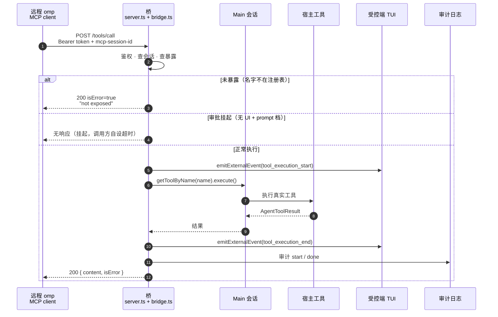

# 协议参考

a2mcp 实现 MCP（Model Context Protocol）`2025-11-25` 的 Streamable HTTP 子集，所有响应为纯 JSON（无 SSE 流）。权威实现是 [`src/server.ts`](../src/server.ts)；本文与代码冲突时以代码为准。使用侧背景（安装、配置、威胁模型）见 [README](../README.md)。

## 传输

| 项 | 行为 |
| --- | --- |
| 端点 | MCP 侧不校验 URL path，任意路径的 POST/DELETE 均受理；惯例用 `/`（`http://127.0.0.1:<port>/`）。两个例外：`/xfer` 前缀是文件路由（见「桥自己的工具：`xfer_*`」），`/host-llm` 见「宿主推理切换」 |
| POST | 单条 JSON-RPC 2.0 消息；**不支持 batch**（顶层数组 → 400）；请求体上限 128MB（`maxRequestBodySize`）。`/xfer/` 上的 PUT 上传受的是同一道上限 |
| GET | 非文件路由 → `405` 空响应体（不实现 SSE 端点与流式推送）；`/xfer/…` 交给文件路由 |
| DELETE | 非文件路由 → 结束会话，见「会话生命周期」；`/xfer/…` 上的 DELETE 原样转发，文件服务器回 403（桥只向它要了上传权限） |
| 其他方法（PUT 等） | 非文件路由 → `405`；`/xfer/…` 原样转发 |
| 响应头 | MCP 响应一律 `Content-Type: application/json`；`initialize` 额外返回 `mcp-session-id`。文件路由是透传，只有逐跳头与 `www-authenticate` 被删 |
| CORS | 不发送（回环工具，非浏览器场景） |

### 请求处理顺序

错误按以下顺序**先到先判**（例如「未鉴权 + 缺会话头」这一条，鉴权在前，给出 401）：

1. 路径与 HTTP 方法：`/xfer` 前缀（`/xfer` 与 `/xfer/…`）是文件路由，方法原样放过；其他路径非 POST/DELETE → 405
2. 鉴权（→ 401）。两个面共用同一个 Bearer token
3. `/xfer` 前缀 → 反代到文件服务器，见「桥自己的工具：`xfer_*`」。不进 JSON-RPC 分支，也不写审计：审计记的是共享的开与停，不是每一次 GET/PUT
4. `/host-llm` 路由（受理 `POST`；这条路径上的其他方法 405，不进 JSON-RPC 分支）
5. body 解析（→ 400 parse error）
6. JSON-RPC 形状校验（→ 400 invalid request）
7. 会话强制，仅对非 `initialize` 消息（→ 400 / 404）
8. `notifications/*` 前缀 → `202` 空响应体
9. 方法分发（未知方法 → `-32601`）
10. 兜底异常 → 500（细节只进宿主 stderr）

## 一个进程，一套端口

服务器是**每进程**的资源，而宿主给它的两个事件是**每会话**的：task 子代理、ACP 会话、持久化 revive 都会新建一套 extension runner 并重跑本入口（模块图不重新求值，所以 `server`/`cfg` 是共享的）。入口的职责就是把这两者对上：

- 第一个 `session_start` 绑定端口，之后的 `session_start` 静默复用同一个服务器，不再广播。绑定这一步不是原子的（`loadConfig` 与 `startServer` 都要 await），所以两个 `session_start` 可以同时在途：后到的等前一个绑完，不另起一套。各绑各的会留下一个谁也停不掉的端口，操作者还会收到两条指向不同端口的广播
- 交给宿主执行的工具属于注册表里的 `Main` 会话（每次调用现取），而审批与通知属于**第一个** `session_start` 那份 `ctx`，之后不再换。交互式宿主里那正是主会话；`/task` 子代理的 `ctx` 没有可用 UI，若让它先占住这份引用，写入类调用会一路挂住
- `session_shutdown` 只在宿主注册表里已经没有 `Main` 会话时释放端口。这里的「没有」按 `AgentRef.session` 是不是 `null` 判：宿主把这个字段注释成「Null exactly when parked/aborted」，槽位还在但会话是 `null` 的那种，`tools/call` 本来也只会回一句 `main session not available`，留着端口只是占着一个没人能用的接口。子代理结束（或被 idle-TTL 停泊）会发出这个事件，那时端口照常服务主会话
- 绑定这一步要 await，所以那个事件可能落在端口落地之前：它手里还没有端口，谁也没停，而绑定随后完成，留下的端口服务的是一个已经不存在的 `Main`。绑完之后再按同一条判据看一次注册表，已经没有 `Main` 就把刚绑的端口收掉，一句广播也不发。这条复查不会挡住正常启动：宿主三个模式（tui、rpc、print）都是在会话已经建好之后才发 `session_start`（`runtime-init.ts:212`、`extension-ui-controller.ts:320-329`），那一刻槽位后面的会话是非 null 的
- 主会话结束时这条判断也就没有 `Main` 可看了：交互式宿主的 `session_shutdown` 是进程退出那一步发的（端口随进程释放），会话型宿主在 dispose 里注销注册表条目。核验只看一件事——没有 `Main` 之后端口不再接受连接，有 `Main` 期间端口一直在
- 释放的动作是**非强制**的 `server.stop()`。强制（`stop(true)`）会把正在处理的那一次一刀切断：客户端拿到 `ECONNRESET`，`tools/call` 的审计只剩 `start` 那一行——那一刀之后 handler 还能不能跑到配对那一行，没有核验过，所以按「无迹可查」对待。非强制那一半实测（Bun 1.3.14）：监听立刻关，之后新建连接一律被拒；已经进来的那一次照常处理完、返回、落审计
- 同一批实测里还有一条偏差要记着：非强制 `stop()` **不关**释放时已经空闲的 keep-alive 套接字（`closeIdleConnections()` 在这个版本只有函数名，返回 `undefined`，socket 照旧；`bun-types` 1.4.2 写的「空闲连接立刻关」是更新版本的行为）。所以释放前就连着、之后仍保持着连接的那一方，在它那一根旧 socket 上还能被服务：`tools/call` 只会拿到 `main session not available`。核验一律按「新建连接被拒」判释放，且用裸 TCP 去连——走 HTTP 客户端的连接池复用，量到的就是这一半而不是监听的状态。这一半是 Bun 的缺口，不是这里已经解决的事

## 宿主推理切换

`POST /host-llm` 是桥唯一不属于工具的那条路。它开关宿主自己会话的模型请求能力：body `{"enabled": <boolean>}`，`false` 在当前 `Main` 会话上装 deny，`true` 按 takeover 的快照恢复（deny api 注销、被声明的 provider 恢复、原始模型行放回、fetch 引用还原、settings overrides 撤销）。响应 `200` 带 `{enabled, denied, degraded}`——`enabled` 是这次调用之后的状态，`denied` 是进程启动以来被拒的模型请求计数，`degraded` 是下面那条降级状态。重复的 `{"enabled": true}` 不报错：没装的时候恢复就是空操作。这个端点不进 `tools/list`，理由与 AGENTS.md 同源：目录透传的是宿主注册表，而这是桥对宿主做的事，不是宿主的工具，不该藏进工具列表里。

deny 是三层的并集，分工按「每条推理请求最后从哪个口出去」划的，判据读自宿主自己的代码（`pi-ai/src/utils/transport-fetch.ts` 是所有推理请求必经的那一个 fetch）：

- **deny api + 宿主当前持有的模型行。** `a2mcp-deny` 注册成自定义 api，它的 `streamSimple` 只计数、只失败；`agent.setModel` 把宿主 agent 手里那一行换成同一行的 deny 副本（agent 持有的是它捕获的 `Model` 对象，不是查表）。宿主自己那一轮因此在建请求之前就被拒：一次尝试，不进重试循环，也不去解析凭据（deny 副本不带 `resolveHeaders`，否则 pi-ai 会在 api 分派之前先跑 provider 的 `!command` 取密钥程序）。返回错误 `a2mcp takeover: host inference is disabled in this mode`，这句话不命中宿主的任何重试触发条件，真实宿主上实测被拒的一轮只发起一次、以 `retryable: false` 终止。
- **目的地绊线。** 包一层宿主进程的 `globalThis.fetch`，URL 主机匹配快照里任一 `baseUrl` 的请求一律拒绝。pi-ai 的取 fetch 顺序是 `options.fetch ?? globalThis.fetch`，取的是全局绑定、每次调用现读，所以这层盖住所有走 fetch 的推理请求——包括自建注册表、不问会话的那类调用者：task 执行器、web 搜索、commit 消息。
- **注册表影子化，只声明不得不声明的那两个 provider。** 有两条道不是 fetch：cowork 道（`provider: anthropic` + `api: anthropic-messages` 时宿主换一个 `node:https` 直连客户端）和 Codex 的 websocket 道（`api: openai-codex-responses`，且宿主把 `providers.openaiWebsockets` 这个设置逐次转发给 provider 调用，所以是按 api 判、不是按行上的标志判）。这两条道的 provider 名字被重新注册到 deny 后面；默认装法下是 73 个 provider 里的 2 个。

另有一个降噪层按住会让宿主自己忙起来的自主源（长命令自动转后台、宿主侧重试、advisor、TTSR、prewalk、autolearn、cache warming、自动压缩），全是运行时 override，不落盘。

**为什么只声明这两个。** `ModelRegistry.registerProvider(name, …, sourceId)` 会把 `sourceId` 记成这个名字的所有者，而别人已经拥有时它先把在位者的运行期状态清掉再接管（overlay、动态模型管理器、discovery 状态、运行期 api key）；公开 API 里唯一的撤销 `clearSourceRegistrations` 是「这个扩展卸载了」，不是「撤销那一次调用」。所以「把目录里每个 provider 都影子化」等于删掉别的扩展注册过的每一个 provider，一次装配删一次、永不恢复——2026-10-13 在真实注册表上实测：一个扩展注册的两行 provider，一次 arm/restore 之后变成零行。同时那个合成的 source id 会进宿主的 `#registeredProviderSources`，而下一次建 session 时的 `syncExtensionSources(扩展路径表)` 会把它当已卸载的扩展剪掉。于是这张表按「哪条道逼的」来写，能不声明就不声明；`restoreTakeover` 也不再假设撤销一定干净，而是拿快照核对被声明的 provider，逐个点名没回来的。

**启动状态与生命周期。** 配置字段 `host_llm`（`"deny" | "allow"`，缺省 `allow`）只决定启动状态。值为 `deny` 时入口在每次 `session_start` 都装一次：绑定端口之前装（端口开着而注册表没影子，等于给早到的调用方留一个宿主还能自己推理的窗口），会话重建之后也装——revive、ACP、task 子代理都会新建 runner，新的 `Main` 会话带着没被影子化的新注册表，端口在不在状态说明不了注册表的状态。**运行期由远端打开的 deny 同样在每次 `session_start` 重装**：宿主自己的扩展源对账可以把影子剪掉，重装是幂等的（`bun run test:registry` 有一项就盯这个）。切换从不落盘，重启回到操作员写下配置时的状态。装例行会把声明的 provider 名字打出来（`takeover armed: 2 provider(s) shadowed (anthropic, openai-codex), 68 tripwire key(s), model pushed: …`）——声明是把名字从原主人手里拿走，而注册表还不回去，所以操作员看得见的只有这一行，探针也靠它才分得清声明表里那两条道各自在不在。`/a2mcp` 显示的是运行态：`host_llm=deny denied=2`。

**降级状态。** 两种拒绝不能读成同一种。启动时拒绝（什么都没装）→ `enabled: true`，宿主按自己的规则推理，这是诚实的读数。而**开关开着的时候拒绝**（会话重建了，新会话的目录里有拦不住的道）→ 开关仍开着、进程级的绊线仍在，但新会话没拿到 deny 行、也没拿到声明，于是两条非 fetch 道在它上面是裸的。这时回包带 `degraded: true`，`/a2mcp` 显示 `host_llm=deny (tripwire only)`，stderr 与审计各留一行说明。装配的拒绝检查排在恢复旧会话**之前**就是为了这个：先恢复再拒绝，等于在失败的路上把绊线也拆了，操作员要 deny 得到的却是连绊线都没有。

**拒绝情形。** 判定顺序与 MCP 路径一致（方法 → 鉴权 → body → 动作）：

| 状态 | 条件 |
| --- | --- |
| `401` | 无 Bearer token（与 MCP 路径同一个） |
| `400` | body 不是 JSON，或 `enabled` 不是布尔 |
| `501` | 服务器没接 takeover 开关（只可能出现在单测自建的服务上） |
| `500` | 装配被拒：没有活的 `Main` 会话，或模型配置里有不在被声明名单里的 provider 带 `transport`（`pi-native` 及任何在 api 分派之前短路的 transport）；响应 `error` 就是原因原文 |
| `405` | `/host-llm` 只接受 `POST`；`DELETE` 不会结束会话 |

装配过程中任何一步抛错都整体回滚再把错误抛出去：agent 那一行、deny api 的注册、fetch 兜底、设置 override 都回到装配前，端点照常返回 `500` 并把原因记进审计。半装状态是最坏的一种——宿主推理被关掉，而端点对「恢复」的回答是「已恢复」——2026-10-13 评审在真实注册表上量到过：抛错后 5457 行全部处于 deny，而 `setEnabled(true)` 回答 `{"enabled": true}` 且救不回来，只有重启宿主能了事。

每次切换在审计里写一条 `tool: "host_llm"`，args 只有 `enabled`，被拒时多一个 `error` 字段。拒绝同样要记——「有人试过装 deny，桥说不行」正是这份日志存在的用途。启动时（配置就是 `deny`）装配被拒不走端点，那里没有调用方也没有 `sid`，所以记的是 `sid: null` 的一条，外加宿主 stderr 一行与界面一条提示：toast 会滚走，审计不会。`sid` 只认桥自己签发过的会话，外面来的头记 `null`。

### 它放弃了什么

- **provider 名字的所有权抢不回来。** 被声明的那两个 provider 若本来就是某个扩展运行期注册的（不是 models.yml 里配的），一次 arm/restore 之后那份注册不会回来：撤销原语没有这个能力。恢复时会点名（`takeover restore left N provider(s) not serving their pre-arm rows …`），不点名就是骗人。
- **不走 `globalThis.fetch` 的请求桥管不着。** 注册表在构造时捕获了自己的 fetch，宿主的目录与元数据 GET（模型列表、目录刷新）因此出得去——**即使那个主机名就在绊线键里**。实测每轮探针的 sink 都会收到一次非 POST，收尾行把它与推理 POST 分开打印。非推理出口不拦是设计如此，但「键内的主机一定被拒」这句话是错的，README 与模块头按实测措辞写。
- **`transport` 拦不住。** 那种 transport 在宿主内部先于扩展注册的任何实现分派，桥排不到它前面。快照里出现「不在被声明名单里的 provider 带 transport」时 `applyTakeover` 在改动任何状态之前抛错——拒绝装配好过装一半。需要 deny 的地方，改的是配置，不是桥。
- **绊线盯的是宿主进程。** `bash` 工具里发出的 `curl`、task 起的进程都在别处，绊线到不了。`deny` 不是网络沙箱，也不自称是。子代理那条路实测封着：它自建注册表、自选模型，deny 状态下它的请求在 fetch 边界被拒（一次本地拒绝，不出网），以同一条 sentinel 结束。
- **运行中新加的 provider 不在 deny 里。** 桥跑着的时候编辑 `models.yml` 新增的 provider，要等下一次装配（重启，或 true→false 再切一次）才进快照、才被绊线盯上。
- **`/login` 把模型所有权交回宿主**（sourceHandoff）。对被声明的那两个 provider，这会让影子失效：影子盖的是桥注册的行，宿主重新掌管的注册表不在它手里。
- **接管期间宿主把模型行换回真行也没用**，它落在绊线上；但恢复时不会把它换回 deny 副本——那是操作员的选择，不是桥该抹掉的状态。
- **`title.generator` 没有关这个值**（枚举只有 `fork | tiny`），宿主仍会尝试生成会话标题；尝试在 deny 层失败关闭，错误通知可能出现在会话里。
- **被拒的轮次仍是轮次。** 宿主会话历史里留下一条错误消息。takeover 限制的是宿主能做什么，不是它记得什么。

### 占位模型

机器上没有模型配置时，交互式宿主的 `Main` 会话带着一个空的模型槽起来，操作者的 prompt 会撞在宿主的提示闸门上（`No model selected`）。桥在每次 `session_start` 补这个空位：向宿主注册 provider `a2mcp` 的一行模型 `offline` 并用 `setModel` 选中它，通知栏说明发生了什么。这一行的 baseUrl 是 `http://a2mcp.invalid/v1`——RFC 6761 的保留域，DNS 永远解析不到；18.12.1 实测，在这样的宿主上发 prompt 报的是 `Couldn't connect to a2mcp.invalid (connection refused)`。选保留域而不是回环地址，为的是 deny 的绊线：绊线按注册表行的主机收键，占位行不该把 `127.0.0.1` 收进键集，而桥自己就监听在那个地址上。

它守三条线。**只填空槽**：`session.model` 有值就一步都不做，操作员选过的模型永远压过桥的占位。**纯运行态**：不写 `agent.db`，不写 `models.yml`，不下 settings override——与接管同一性质，宿主重启后磁盘上没有桥留下的任何模型。**sourceId 是 `a2mcp-auto-model`，不是接管的 `a2mcp`**：restore 走 `clearSourceRegistrations` 按 source 拔注册，同名会连这张占位行一起拔走，两个功能的账不能记在同一个名字下。宿主每次新建会话都会做扩展来源对账（`syncExtensionSources`），剪掉扩展名下的注册，所以这张行在每个 `session_start` 重放一次：行在就不重注册、只补选中，行被剪了就重新注册。占位行没有 `transport`，走的是 fetch 道，因此 deny 在位时它照常进绊线键集——`host_llm: "deny"` 与占位模型同场是实测过的（`bun run test:takeover` 全绿的那一遍就带着这段接线）。

占位模型不产生推理，也不该被当成能用的模型：它把「这台机器没配模型」从一个启动期的硬报错变成一个运行期的连接失败，为的是桥的 MCP 面在这种机器上照样起得来。它救不了无头启动：`omp --mode rpc` 在 `createAgentSession` 里就死，那时桥的代码还没跑过，唯一来得及在场的是磁盘上的 `~/.omp/agent/models.yml`。两份引导脚本都写这个文件，条件一样窄：脚本自己装了宿主，且该文件不存在（create-only；已有文件一个字不碰，PATH 上本来有宿主的机器什么都不写）。文件形状与运行态那张行同名同值：

```yaml
providers:
  a2mcp:
    baseUrl: http://a2mcp.invalid/v1
    api: anthropic-messages
    apiKey: not-a-real-key
    models:
      - id: offline
        name: a2mcp placeholder (unreachable)
        contextWindow: 100000
```

`apiKey` 是内联的假值：宿主的默认可用模型选择按「有没有具体凭据」过滤，占位行要能被选中就得带它；这个 key 发不出去，因为域名根本不存在。真配模型的机器不需要这份文件，`/login` 之后 `/model` 选一个就是正常宿主。

## 鉴权

每个请求（含 `initialize` 与 `DELETE`）在任何状态变更之前校验：

- 头：`Authorization: Bearer <token>`，scheme 大小写不敏感（`/^Bearer\s+(.+)$/i`）。
- 比较为常数时间（先比字节长度）；失败返回 `401`，响应体 `{ "jsonrpc": "2.0", "id": null, "error": { "code": -32000, "message": "unauthorized" } }`。
- 不返回 `WWW-Authenticate` 头。token 来源与轮换见 README「配置」「命令」。
- token 的强度下限写在配置装载里：`a2mcp.json` 里现成的 token 少于 32 个字符，或者含空白，`loadConfig` 按其他字段同样的 fail-closed 处理，抛错，桥不起。这里故意不自愈：换一个更强的 token 会把某人自己写下的那份换掉，远端 `mcp.json` 从此 401，而日志里没有任何一句解释为什么。生成出来的是 43 个字符（32 随机字节，base64url），下限留在 32，拦的是手填的占位值，不是从别处拷来的秘密。
- 鉴权失败不进审计日志，进宿主 stderr：第一次一条，此后每 50 次一条（`[a2mcp] N unauthorized attempt(s)`）。这份日志只保得住一代记录；把写入开放给还没鉴权的流量，等于让任何没有 token 的人用洪水面把真实记录推出窗口。会话错误（缺头 400、未知 404）与 `tools/list` 同样只在响应里体现，不留记录。

## 会话生命周期

1. `POST initialize`（**不需要**会话头）→ `200`，响应头 `mcp-session-id: <uuid>`。**每次** initialize 都签发一个新会话。
2. 此后的**所有**请求与通知都必须携带 `mcp-session-id: <uuid>`。
3. 每次命中刷新 24 小时空闲计时（TTL 跟踪的是空闲时间）；上限 64 个会话，满时在新 `initialize` 处淘汰最久未见者。
4. 主动结束：已鉴权的 `DELETE` → `204`，幂等（未知或缺失会话头同样 `204`，只是不删任何东西）。
5. 会话是宿主**进程内存态**：宿主重启即全部失效；过期与不存在的会话统一返回 `404 unknown session`。

## 方法

### `initialize`

```json
{ "jsonrpc": "2.0", "id": 1, "method": "initialize", "params": { "protocolVersion": "2025-11-25" } }
```

```json
{
  "jsonrpc": "2.0",
  "id": 1,
  "result": {
    "protocolVersion": "2025-11-25",
    "capabilities": { "tools": {} },
    "serverInfo": { "name": "a2mcp", "version": "<package.json 的 version>" }
  }
}
```

- `protocolVersion` **恒为** `2025-11-25`：服务器只说一个版本，不回显请求值（请求 `1999-01-01` 也得到 `2025-11-25`）。
- `params` 其余内容被忽略。
- 响应头 `mcp-session-id` 即新会话 id。

### `ping`

→ `200 { "jsonrpc": "2.0", "id": <id>, "result": {} }`。用于存活探测（挂起调用之后服务器仍应答 ping）。

### `tools/list`

→ `200 { "result": { "tools": [ { "name", "description", "inputSchema" } ] } }`

- **无 `nextCursor`**：单页返回全量（宿主 omp 客户端的分页循环在缺省游标时正常终止）。
- `inputSchema` 为 JSON Schema 2020-12（由宿主工具的 typebox schema 经 `toolWireSchema` 导出）。
- 内容 = 宿主 `Main` 会话的工具注册表（`AgentSession.getAllToolInfos()`——宿主也正是用它接出 `pi.getAllTools()`），**原样透传不过滤**：含 `hidden` 工具，也含宿主当前对自己模型禁用的工具。**目录 = 宿主注册表逐字 + 桥自己的三个名字（`xfer_share` / `xfer_status` / `xfer_stop`，见下），没有别的**；桥也不解释权限——语义详见 README「安全与边界」。目录、暴露门与执行读同一份注册表，所以「列出来却调不动」只剩两次读之间工具被注销这一种情形。没有活的 `Main` 时（parked/aborted 到端口释放之间那一段）退回入口那份 `pi` 的视图，而不是报出一份宿主其实并没有的空目录
- 请求可带 `params.cursor`，被忽略。

### 桥自己的工具：`xfer_*`

`tools/list` 里那三个名字不是宿主的工具，是桥自己服务的（`src/xfer.ts`）。**按「`tools/list` 里每个名字都是宿主工具」写死的客户端要改：目录是宿主注册表逐字加恰好这三个。** 三者都由桥分派，不进宿主的 `getToolByName()`，也不过宿主的审批门；每次动作写一条审计，`tool: "xfer"`（`phase: "done"`，`args.action` 为 `share` / `close` / `stop` / `install`，`args` 带路径、本地端口、TTL 与路由，不含任何内容）。

**`xfer_share`** — 参数 `{ path, ttlSeconds? }`。`path` 必填，是文件或目录（`~` 与 `~/x` 展开到宿主家目录，相对路径按宿主的 working directory 解析）；`ttlSeconds` 缺省 3600。成功时 `result.content[0].text` 是一段 JSON：

```json
{ "url": "http://127.0.0.1:44347/xfer/",
  "route": "/xfer/",
  "path": "<绝对路径>", "port": 52137, "replaced": false,
  "startedAt": "2026-10-16T04:35:23.000Z", "expiresAt": "2026-10-16T05:35:23.000Z",
  "usage": { "download": "curl -H 'Authorization: Bearer <TOKEN>' -O http://127.0.0.1:44347/xfer/<name>",
             "upload": "curl -H 'Authorization: Bearer <TOKEN>' -T <local> http://127.0.0.1:44347/xfer/<name>",
             "public": "the same /xfer/ path under the operator's public hostname while `/a2mcp tunnel` is open; loopback or an SSH forward only when it is not" },
  "installed": { "dufs": null } }
```

- 共享不再有公网那一半：桥把 `dufs` 反向下代理到自己端点的 `/xfer/` 路由上，`url` 就是那条路由，`port` 是 `dufs` 自己听的回环端口。`usage` 里的 `<TOKEN>` 是占位符，桥不回自己的 token——拿着 token 的人配置里读得到，回包里不需要再抄一份。
- 代理的契约（`src/server.ts` 的 `proxyXfer`）：`/xfer` 前缀之后的路径**逐字转发**，query 带上（`?json` 可用）；`Authorization` 一律换成桥为这次共享生成的 basic-auth 对，调用方带什么都不影响；逐跳头两边都删，回包额外删 `www-authenticate`；`Accept-Encoding` 改写为 `identity`，避免上游压缩后桥再压缩一遍；`redirect: "manual"`，上游的 3xx 原样报给调用方而不是由桥跟着跑。`dufs` 起不来或共享已经关掉，回 `502`，端口号只进宿主 stderr。
- 路径逐字转发靠的是 `dufs --path-prefix /xfer`：目录列表里的绝对引用、`?json` 的 `uri_prefix`、WebDAV 的 `D:href` 都带着前缀，跟着一个链接不会掉出路由。不加这个旗标时它们写成根绝对路径（`/__dufs_v0.46.0__/index.css`、`/up.txt`），代理剥掉前缀就全指错地方——这一条是 0.46.0 真机量出来的，`test:obtain` 与 `test:install` 每轮各验一次。
- 桥只向文件服务器要了上传（`--allow-upload`），`DELETE` 与 `MOVE` 回 403；`MKCOL`、`PROPFIND`、Range 与目录列表是 `dufs` 自带的能力，WebDAV 客户端和浏览器都能直接用。
- 同一时刻只有一个共享：第二次 `xfer_share` 先关掉前一个，回包 `replaced: true`。
- 文件服务器由桥自己找（`src/obtain.ts`）。配置里的值带 `/` 或 `\` 就按那条路径用，缺了也不下载，这是「这台机器不许下载」的写法；不带分隔符就扫本机 `PATH`（Windows 中按 `PATHEXT` 的后缀逐个试），其次复用桥自己装过的那一份（登记在 `<agentDir>/a2mcp.installs.json`），都没有才去下载：版本与 asset 名是代码里的字面量，字节回来先比对同一处钉住的 sha256，再取出要的那一个文件——`.tar.gz` 交给 `tar` 解到临时目录并检查条目没跑出目录之外，`.zip` 在本仓库自己的读取器里展开那一个条目、一个字节都不落盘，裸 `.exe` 直接就是它——最后以 `0755` 原子写入安装目录（Windows 上文件名带 `.exe`，目录是 `%LOCALAPPDATA%\a2mcp\bin`；`0755` 是 POSIX 的位，在那边没有意义）。不请求 `latest`，也不向给字节的那台服务器要校验和；升级是改这个仓库的一次提交。桥不会覆盖一个不是自己装的文件，报它的哈希了事。两条都钉死了 Linux x64/arm64、macOS x64/arm64、Windows x64 五项：`dufs` 0.46.0（Linux 取 musl 静态构建，Windows 是 zip 里的 `dufs.exe`），`cloudflared` 2026.10.1（Linux 是裸 ELF，macOS 是 `.tgz` 里一个 `cloudflared`，Windows 是 `.exe`）。`win32-arm64` 这一行是空的，因为上游不发 `cloudflared` 的那个构建；两张表是共享还要两个二进制那会儿一起钉的，如今 `xfer_share` 只需要 `dufs`，这一行可以单补文件服务器，目前没补。下载过三道门：64 MB 的体积上限、30 秒的无字节空闲窗、10 分钟的总期限。空闲窗在请求发出前就武装、每来一块字节就重新计时，连接死了 30 秒内就报，不会拖满总时长；还在进字节的慢流可以一路跑到总期限。这个形状是 2026-10-20 一次真机读数换来的：此前是一道 120 秒的墙上时钟管全身，慢连接与死连接拿的是同一句 `The operation timed out.`，Windows 主机上 52.7 MB 的 `.exe` 在它里面取不完（450 KB/s 起步的门槛）。超时之外还有一种失败：哈希与钉值不符则拒绝安装，说的是字节本身。两条超时都点名逃生门——把二进制放上 `PATH`，或在配置 `xfer.<name>` 写它的绝对路径，桥就按原样用、不再下载。`bun run test:obtain` 每轮把钉表里十个 asset 的 URL 全部 `HEAD` 一遍，本机这一行真下、真跑，Windows 那两行真下、只到字节为止（zip 解出 `dufs.exe`、`.exe` 认出 PE 头），跑不了。
- 失败一律 `200` + `isError: true`，text 就是原因：缺 `path` 为 `xfer_share needs a 'path' — the file or directory to serve`；路径 `stat` 失败为 `cannot serve <path>: <原因>`；文件服务器起不来为子进程的错误原文。获取二进制失败的另外写一条 `install` 审计，带上是哪个 asset、钉的是哪个哈希；成功的那条同样在 `spawn` 之前落盘。

**`xfer_status`** — 无参数。有共享：`{"serving": true, "path", "port", "url", "route", "startedAt", "expiresAt"}`；没有：`{"serving": false}`。

**`xfer_stop`** — 无参数。有共享：`{"stopped": true, "path"}`；没有：`{"stopped": false, "note": "nothing was shared"}`，没共享也不报错。

**关闭时机**：TTL 到期、`xfer_stop`、或桥停止（宿主退出）。到期与顶替走同一条关闭路径——`dufs` 收 `SIGTERM`，等它真的退出（监听先注册再发信号，`exit` 只发一次）——并写一条 `xfer` 审计（`args.why` 为 `replaced` / `ttl expired` / `bridge stopped`）。关完之后 `/xfer/` 回 404。

**token 是能力**：拿着它的人，在共享关闭之前能读能写那条路径。每次共享生成的那对 basic-auth 只出现在桥代发的请求里，工具回包、审计记录、文档都不写它；`www-authenticate` 被删掉，调用方看不到它的存在。

### 操作员的隧道：`/a2mcp tunnel`

宿主会话里的命令，不是 MCP 方法也不是 HTTP 端点：它出现在 `tools/list` 之外的唯一理由是它根本不在协议面上——持 token 的远程调用方打不开它，只有坐在宿主会话里的操作员能。它做的事是把 `openQuickTunnel`（`src/tunnel.ts`）与 `resolveBinary`（`src/obtain.ts`）这两个部件指向桥自己的端口：一条随机 `https://<随机>.trycloudflare.com` 主机名，公网那一侧到此为止，`Authorization` 头之后才是宿主工具。quick tunnel 只接受一个 `--url`，所以顶的是整个端口：MCP 端点和开着共享的 `/xfer/` 路由共用这一个主机名。

- **运行态**。与 takeover 开关同款：不落盘、不进配置、重启即无。每进程一条（`server` 每进程一条），第二次 `/a2mcp tunnel` 复用已开的那条并重报 URL，不另起子进程——这与 `xfer_share` 的「第二次顶掉第一次」刻意相反，因为这里没有「该换哪条」的语义。两个命令同时在途由在途保护合并成一个 spawn（与 `bringingUp` 之于绑定同一条规则）。
- **生命周期**。`/a2mcp tunnel stop` 关闭；`session_shutdown` 释放端口时一并拆（SIGTERM，两秒不退补 SIGKILL），公网主机名不活得比开它的桥久。
- **审计**。开与关各一条 `tool: "tunnel"`（`phase: "done"`，`sid: null`——操作员发起，没有调用方会话可归属），`args.action` 为 `start` / `stop`，带 `url` 与本地 `port`；打开失败的记录带 `error` 原文。token 不进记录，主机名本身不是秘密。
- **cloudflared 从哪来**。与「传文件」那一节完全同一套：`xfer.cloudflared` 带 `/` 或 `\` 就按路径用（不许下载的那台机器的写法），否则 PATH、桥装登记、钉版本+sha256 拉取；安装另记一条 `install`。

边界只有一处要说清：隧道一开，出公网的是整个端口，正开着的 `/xfer/` 共享跟着一起出去；隧道关着，文件路由只在回环或 SSH 转发后面。隧道本身的可用性取决于 Cloudflare 边缘，30 秒内等不到主机名就报错了事；本机网络对 `*.trycloudflare.com` 重签 TLS，公网半程的回环验证只能算人工证据（见 `docs/testing.md`）。

### `tools/call`

```json
{ "jsonrpc": "2.0", "id": 2, "method": "tools/call", "params": { "name": "read", "arguments": { "path": "/etc/hostname" } } }
```

三种出口：

1. **成功 / 工具内部拒绝**：一律 `200`，`result = { "content": [...], "isError": <bool> }`。工具抛错（审批拒绝、参数校验失败等）进 `isError`，**不**变成 HTTP 错误。`content` 元素为 `{ "type": "text", "text" }` 或 `{ "type": "image", "data", "mimeType" }`；宿主侧工具结果的类型就只有这两种，第三种（自定义工具绕过类型声明）折成 `text` 的 JSON，桥不把客户端解析不了的内容类型发出去。image 这条路径是真的：`AgentToolResult.content` 的声明就是 text 与 image 两种，宿主 `read` 的文档写明支持图像文件，浏览器截图与图像生成工具也产出 image 块，`data` 是 base64。宿主侧的 `detail`（OpenAI 的分辨率提示）在 MCP 的内容类型里没有对应字段，因此不透传。
2. **未暴露**（不在注册表里，含别名如 `xd://bash`）：`200` + `isError: true`，text 含 `not exposed`。未注册与不存在**共用同一文案**，不泄露名字是否存在。
3. **审批挂起**（宿主无交互 UI 且工具为 `prompt` 档）：**没有响应**——请求会一直挂起（实测 ≥90s）。调用方必须自设超时；审计日志留 `start` 无 `done`。详见 README「审批」。

补充：

- `arguments` 原样透传给宿主工具执行（在宿主 `Main` 会话上下文中）。桥自己的日志把超过 120 字符的字符串折成 `<len:N,sha256:前8位>`，**逐层折到叶子**，宿主 `edit` 的正文落在 `args.edits[0].oldText`（第三层）也在覆盖范围内；宿主会话收到的还是原参数，宿主的记录不由本桥管。
- 每次 `tools/call`（包括被拒绝的）都写一对审计记录，见 README「审计日志」。日志有两处读者容易踩空的地方，`test:hardening` 第 9b 组实测过：其一，记录里的 `id` 是本桥为配对生成的 UUID，**不是**调用方发来的 JSON-RPC id，所以按 JSON-RPC id 查日志查不到任何东西；其二，轮转只保留一代（过 512 KB 就把当前文件改名成 `.1`，下一代再把 `.1` 覆盖掉），因此日志是一份滚动窗口：后续调用把它推过两代，一次挂起的 `start` 证据就从两个文件里同时消失。用日志判挂起，要在轮转窗口内读，且要把 `.1` 与当前文件一起看。落盘按进程一条队列串行，因为 `stat` 查大小、`rename` 轮转、`appendFile` 写行这三步不是一个整体：两个并发写都读到越过上限的尺寸就会都轮转，第二次 `rename` 覆盖的正是第一次放好的那个 `.1`，被吃掉的是那一刻还留在当前文件里的记录。这条不是假想——同一份未串行的代码重跑六轮，最坏的一次两个文件各剩 1 条，测试摆到磁盘上的 572 条记录里有 570 条在两个文件里都找不到；最轻的一次是并发那 60 条只剩 1 条。串行之后「一代窗口」才是文档里那个意思：只由尺寸决定，不由并发决定。
- **记录先于响应落盘。** `tools/call` 的 `start` 在工具真正执行之前落盘，`done` 在响应发出之前落盘。拿到的 200 意味着那一行已经在盘上，调用方紧接着读日志不必轮询。这一条以前是反的：落盘走进程内一条队列、调用方不等它，于是响应会跑在记录前面，而它是**偶发**的——只有磁盘慢到队列排得上时才看得见。实测代价是每条记录约 99 µs（`stat` + `appendFile` + `chmod`，串行），对着一次 bash 调用或一次文件读取可以忽略；慢的磁盘推迟的是响应，不是记录，这正是要的取舍。队列本身仍然从不 reject，所以写失败不会变成一次失败的调用（记一条 stderr，计入 `auditWriteFailures()`）。附带修好的还有那个证据设计本身：`start` 一旦不排在工具执行之前，「进程死在调用中途、只剩 `start` 没有 `done`」这条判据就是假的——工具的副作用会先落地，那个窗口里崩掉就什么痕迹都不留。
- `params.name` 缺失按空串处理（走向出口 2）。

下面的时序图是 `tools/call` 的一次完整往返，含受控端 TUI 的显示与审计：



图上那两条 `emitExternalEvent` 只管渲染：受控端的 TUI 因此把一次远程调用画成与本地调用相同的卡片，同样的开始/结束生命周期。它们不参与返回值判定。宿主若不接受这个事件（会话形状来自另一个版本、事件总线的入口不是函数），桥照常执行工具、照常把工具自己的结果与错误文本交给调用方。这两个调用此前坐在判定结果的那个 `try` 里，于是渲染失败能让一次已经落盘的 `edit` 报成失败，也能把工具真正的错误换成渲染自身的错误；调用方按 `isError` 重试，就重复执行了一次带副作用的写。

`toolCallId` 每次调用新生成（UUID），不复用调用方的 JSON-RPC id：宿主按 id 渲染卡片，复用会把两次远程调用合成一张。

### `notifications/*`

方法名以 `notifications/` 开头（如 `notifications/initialized`）→ `202` 空响应体。仍需通过会话强制（缺头 400 / 未知 404）。

### 未知方法

→ **HTTP 200** + `{ "error": { "code": -32601, "message": "method not found" } }`（注意是 200，不是 404）。

### 无 id 消息

严格 JSON-RPC 中无 `id` 即通知、不应有响应；本服务器只认 `notifications/` 前缀——其他无 id 消息会得到 `id: null` 的响应。客户端应按规范用 `notifications/` 发通知。

## 错误码总表

| HTTP | JSON-RPC `code` | `message` | 触发条件 |
| --- | --- | --- | --- |
| 401 | -32000 | `unauthorized` | 缺失/错误的 Bearer token |
| 400 | -32700 | `parse error` | body 不是合法 JSON |
| 400 | -32600 | `invalid request` | batch 数组、`jsonrpc` ≠ `"2.0"`、`method` 非字符串、非对象 body |
| 400 | -32000 | `missing mcp-session-id` | 非 `initialize` 消息未带会话头（请求与通知同样处理） |
| 404 | -32000 | `unknown session` | 会话不存在或空闲超 24h（过期条目顺带清理） |
| 405 | — | （空体） | GET 或非 POST/DELETE 方法 |
| 500 | -32603 | `internal error` | 服务器内部异常；**响应体固定为该文案**，细节只打到宿主 stderr（`[a2mcp] internal error:`） |
| 200 | -32601 | `method not found` | 未实现的方法 |
| 200 | （result） | `isError: true` | 工具侧拒绝 / 未暴露（text 含 `not exposed`） |

所有错误响应体形如 `{ "jsonrpc": "2.0", "id": <id 或 null>, "error": { "code", "message" } }`。

## 客户端接入时序

1. `POST initialize` → 记下响应头 `mcp-session-id`。
2. （可选）`POST notifications/initialized` → 202。
3. `POST tools/list` / `POST tools/call`，都带 `Authorization` 与 `mcp-session-id` 两个头。
4. **每次调用设置超时**（审批挂起时唯一能解开客户端的手段；用审计日志判定挂起）。
5. 退出时 `DELETE`（可选，释放会话槽位）。

与宿主 omp 自带 MCP 客户端实测兼容（协议 `2025-11-25`、纯 JSON 响应、initialize 后自动附带会话头）。远端跨机场景用 SSH 转发，见 README「跨机转发」。

这段时序有一份可执行参考：`scripts/mcp-call.py`（零依赖 Python 3，走 raw URL 交付、不在安装 tarball 里）。会走 MCP 的客户端不必用它，直接 `mcp.json` 接入；它给的是「能跑代码、但不是 MCP 客户端」那一侧，把会话头、404 重握手、超时和退出码都落成了代码，细节见 README「两条接入路」。

## v1 未实现面

resources、prompts、SSE 推送、调用取消、并发/速率限制、OAuth/TLS——完整边界见 README「v1 边界」。

